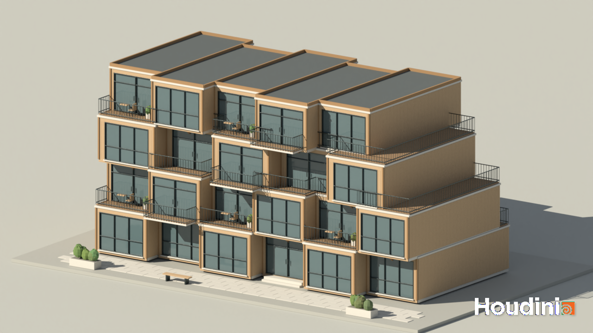
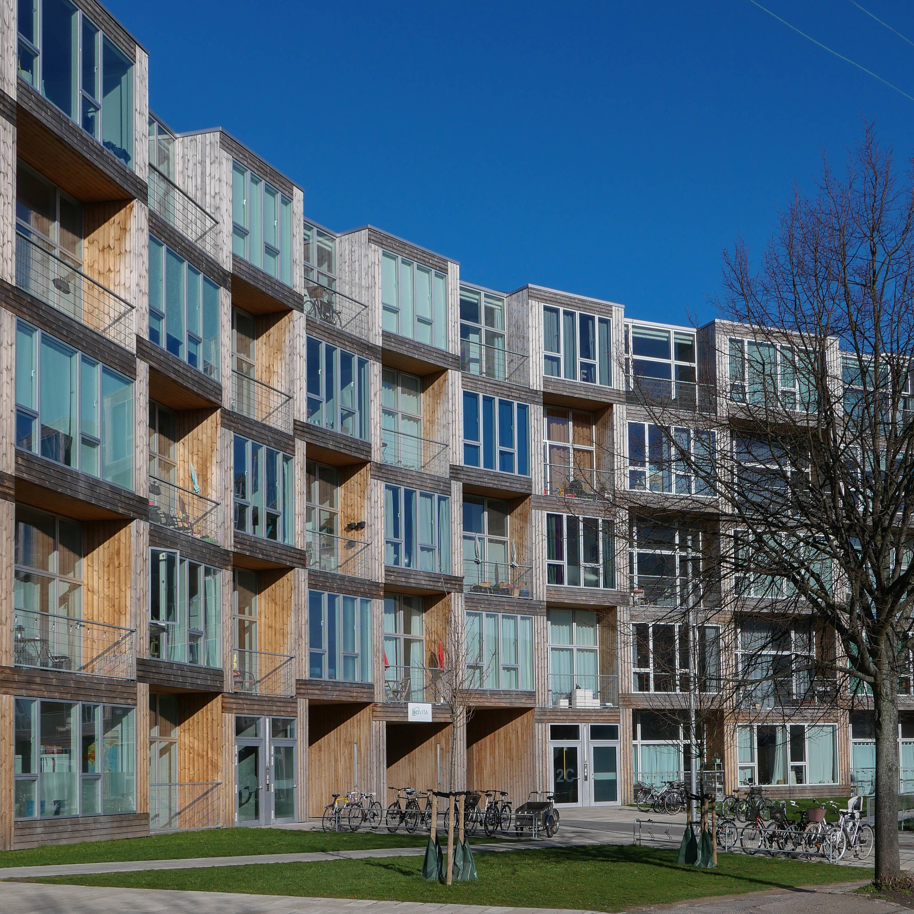
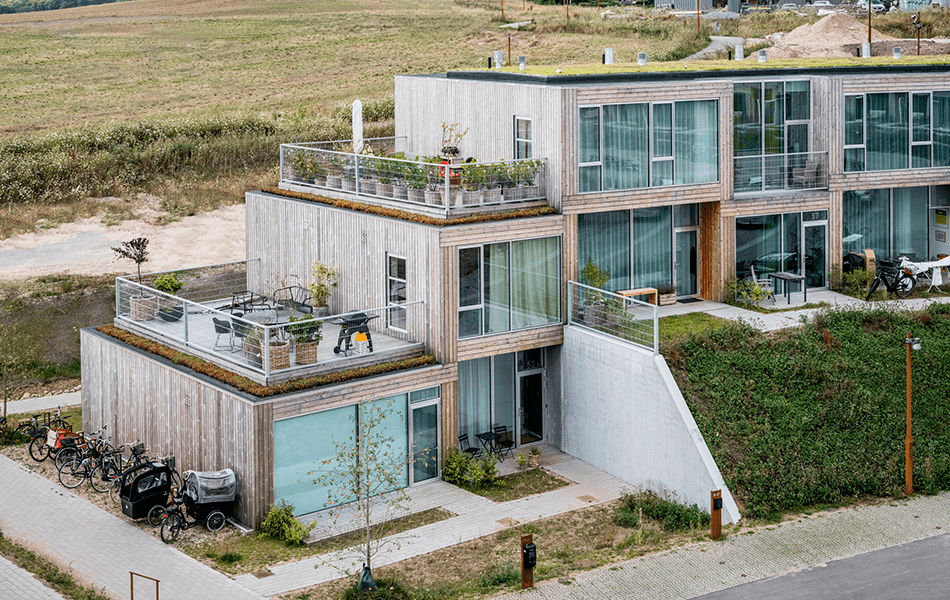
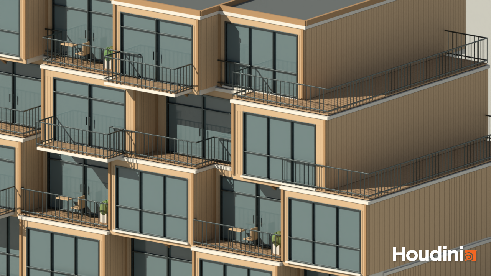
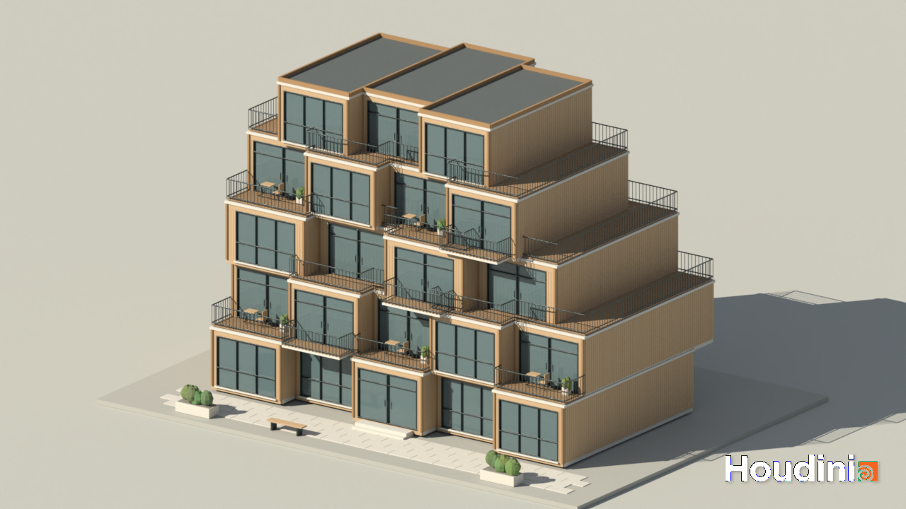

# CIS 5660 HW04 Procedural Buildings

## Terrace Weave

A procedural housing tool in Houdini, inspired by BIG's Dortheavej Residences and Sneglehusene Housing. I focused on repeated timber modules, deep window frames and outdoor terraces, using alternating recessed bays to give the façade its rhythm.

## Tool demo

https://github.com/user-attachments/assets/b903042e-ac2f-48ba-a012-f00ac175f58a

## Design references

| Dortheavej Residences — Copenhagen | Sneglehusene Housing — Aarhus |
| --- | --- |
|  |  |
| [BIG project](https://css.big.dk/projects/dortheavej-2-residences-2442) · [Photo source](https://danishdesignreview.com/apartment/2019/4/1/dorotheavej-apartments-by-big) | [Architect's description](https://www.archdaily.com/989940/sneglehusene-housing-big) · [Photo: Rasmus Hjortshøj](https://traeinfo.dk/sneglehusene/) |

My versions adapt the references' stacked modules and outdoor spaces to smaller, rectilinear buildings, with timber cladding, large glazed openings and thin metal railings.

## Generator

One HDA controls floor count, per-floor dimensions and X/Z offsets, recesses and setbacks. Native Box and Copy to Points nodes build the stack and place façade components; Python SOPs calculate the layout, terraces and supports.

Windows, doors and balconies are modeled in Houdini, each with its own Null controller:

| Component | Exposed controls |
| --- | --- |
| Window — `CTRL_WINDOW` | Width, height, pane count |
| Door — `CTRL_DOOR` | Width, height, single/double door |
| Balcony — `CTRL_BALCONY` | Width, railing height, depth, baluster spacing |

Repeated uprights and floor borders define the modules. Diagonal braces connect overhangs to the floor below, with their drop adjusted to the overhang length. Each detail has a separate toggle.

## Custom feature: automatic terraces

My main addition is a terrace system that responds to the building's shape. It subtracts the upper floor's footprint from the lower one to find exposed roof areas, then adds timber decking and railings along the open edges. Shared edges and edges against walls receive no railing. Where enough deck space exists outside a façade bay, the tool places a terrace door.

Moving or resizing a floor updates the deck, railing boundaries, door placement and overhang supports together.

## Two variations, one tool

The four-storey version emphasizes alternating bays; the five-storey version uses stronger setbacks and offsets for larger terraces. Both use the same HDA and components, with different parameter values.

## Extra Credit

The three images above are Karma renders with procedural wood grain, glass and metal materials. A warm sun, soft environment light and a neutral ground plane frame the building; planters, terrace furniture and a bench give the scene a residential scale.

## Open the project

Open [hw04.hipnc](hw04.hipnc) in Houdini Apprentice 22.0 and select `/obj/TERRACE_WEAVE/BUILDING_GENERATOR`. The **Building**, **Components** and **Details** tabs expose the controls. The HDA and procedural materials are embedded; no external textures or plugins are required.

The base workflow follows [Simon Houdini's procedural building tutorial](https://www.youtube.com/watch?v=uIe97023sDk). Architecture and photograph credits are listed in [REFERENCES.md](REFERENCES.md).
