# HW 4 - Procedural Buildings

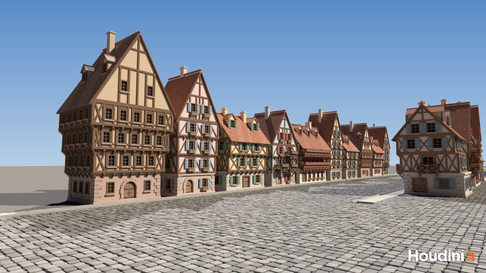

**Tool in action:** [Screenshots/tool_demo.mp4](Screenshots/tool_demo.mp4) (full Houdini window, 36 s)

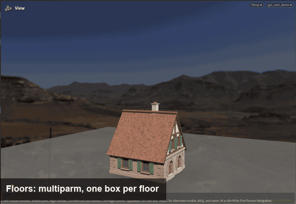

Scene is `hw04_buildings.hipnc` (Houdini 22.0.466 Apprentice, hence the watermark), submitted on Canvas. The tool is the `timber_house` HDA, **embedded in the hip file**, and every house in the scene is one instance of it with different parameters. I started from my lab 06 building generator. No SideFX Labs nodes.

## Style: half-timbered houses in Strasbourg

| Kammerzell House | Tanners' House (Maison des Tanneurs) |
|:--:|:--:|
|  |  |
| Photo: Zairon, [Wikimedia Commons](https://commons.wikimedia.org/wiki/File:Stra%C3%9Fburg_Maison_Kammerzell_1.jpg), CC BY-SA 4.0 | Photo: Pedro J Pacheco, [Wikimedia Commons](https://commons.wikimedia.org/wiki/File:Maison_des_Tanneurs_front.jpg), CC BY-SA 4.0 |

What they share, so one tool can do both:
- stone ground floor, timber-framed floors on top
- upper floors stick out over the street (jetties) on brackets
- lots of small-paned windows, flower boxes
- steep tiled roof, timber frame carrying on into the gable, dormers

Kammerzell has its gable to the square and three jetties stacked on each other. The Tanners' House turns its long side to the river and has two wooden galleries full of geraniums.

Mine, same HDA, different parameters:

| Kammerzell preset | Tanners' preset |
|:--:|:--:|
| 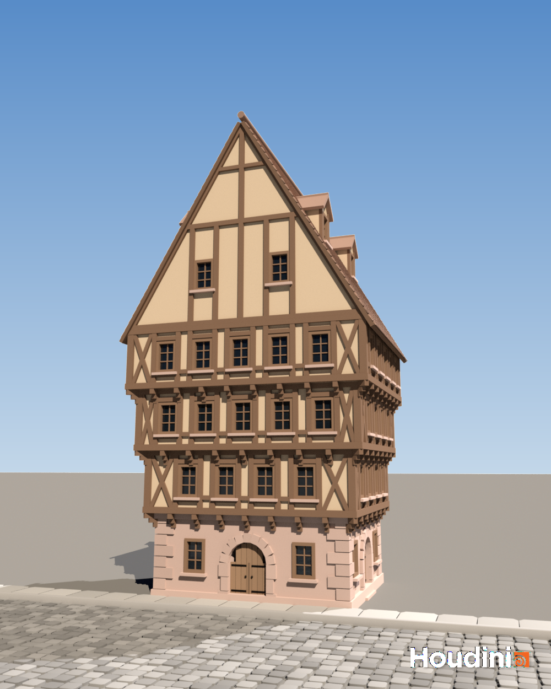 | 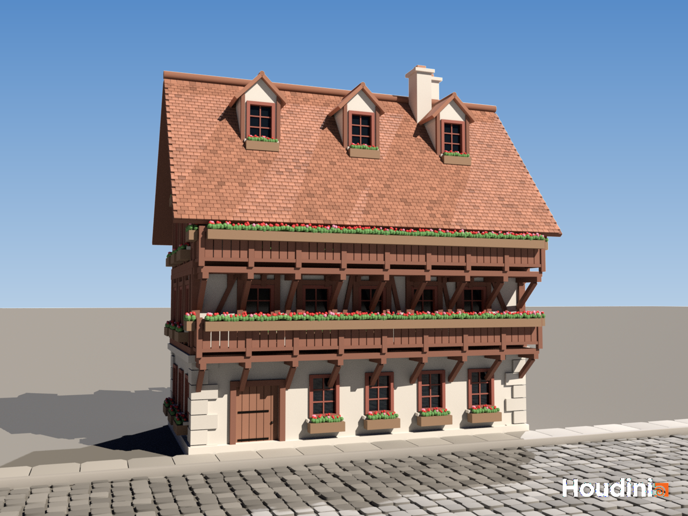 |

## The asset

| | |
|:--:|:--:|
| 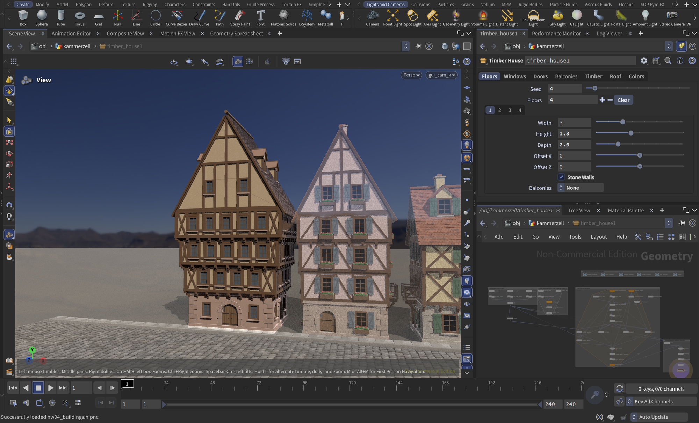 | 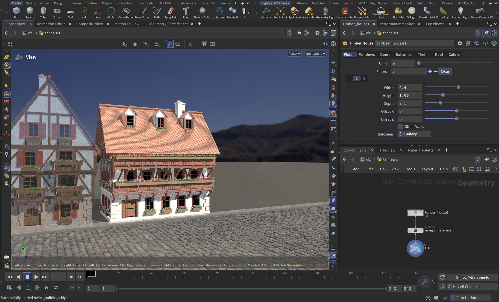 |

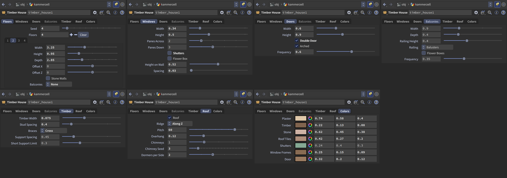

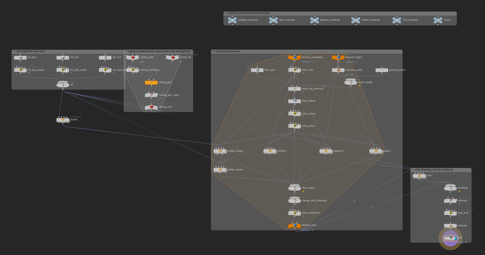

## Part 1: stacking boxes

Same as lab 06: `Floors` multiparm (tabs), for-each block with fetch feedback + fetch metadata, box size from `ch(strcat("../x", detail(-1, "iteration", 0) + 1))`, Match Size onto the walls of the floors below.

New per floor: `Offset X/Z`, `Stone Walls` and `Balconies` (none / random / gallery). A `floor_info` wrangle reads the current floor's tab into detail attributes, so the subnets don't all have to build parm names.

## Part 2: windows, doors, balconies

All three live in the `assets` subnet. Each model is a detail wrangle that adds one point per part (centre, size, orient, colour, material), then Copy to Points puts a unit box, sphere or tube on each point. Every model also has a cut box (booleaned out of the wall) and a footprint box (how much wall it takes up).

Control nulls: `window_controls`, `door_controls`, `balcony_controls` (plus `timber_controls`, `roof_controls`, `colors`). Their parms are promoted to the asset's tabs.

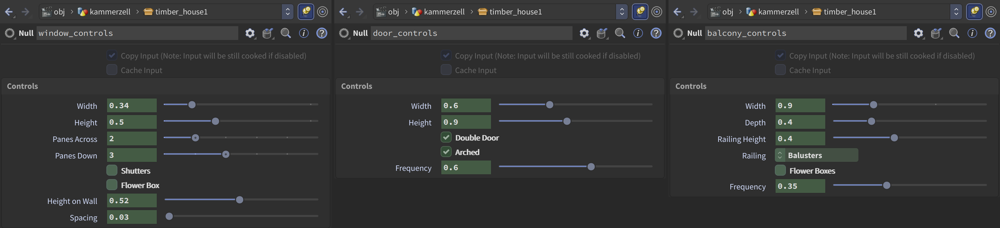

| Window | Door | Balcony |
|---|---|---|
| width, height | width, height | width, depth, railing height |
| panes across / down | single or double | balusters / boards / cross braces |
| shutters, flower box | arched with a stone surround, or square | flower boxes |
| height on wall, spacing | how often | how often |

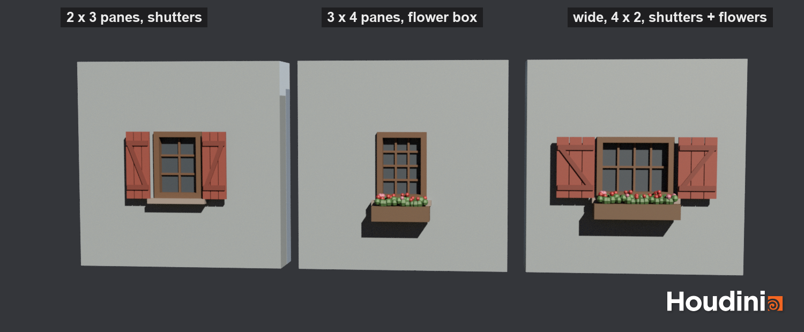
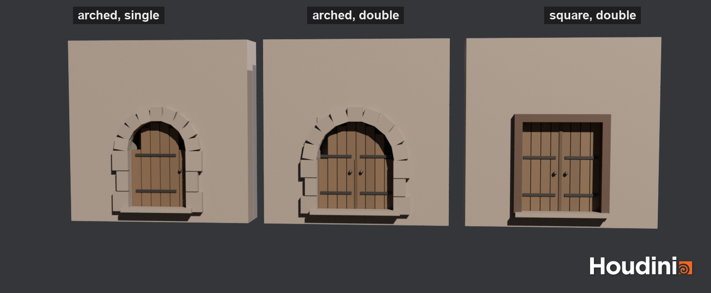
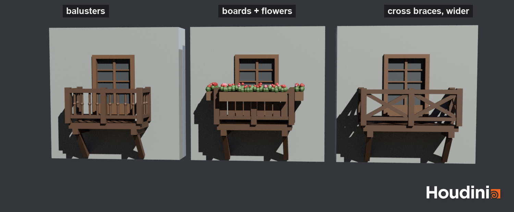

Placement is the lab 06 chain setup (`scatter_assets`):
- bottom edges of the floor, pulled in from the corners and lifted to window height
- footprints packed by `id`, Chain set to *Weighted Random from Attribute* (door and balcony frequency are the weights)
- points get centred on each wall, doors drop to the floor
- copy models + cut boxes onto the points, boolean the cut boxes out of the wall
- doors only on the ground floor, balconies only above it, arched doors only in stone walls (timber floors get the square one)

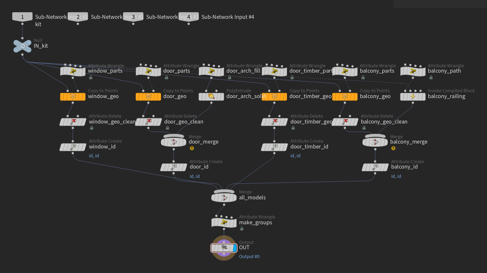

## Part 3: pillars and borders

- **Pillars**: corner posts on timber floors, quoins on stone floors, copied onto the 4 bottom corners like the lab 06 pillars
- **Horizontal instancing** is the half-timbering. `frame_members` walks each wall, puts a post on both sides of every opening, fills the gaps with studs (`Stud Spacing`), adds rails under and over the windows and braces in the empty bays (none / diagonal / cross). Diagonals lean towards the middle of the wall.
- **Borders**: sill and top plates swept around each floor, sandstone plinth and cornice on stone floors

## Part 4: supports

Lab 06 setup: bottom of the floor minus the top of the floor below = the overhang, its outer edges resampled, each point rayed back onto the wall below. Now every point gets a joist, then it depends on the length:
- short (under `Short Support Limit`): stepped corbel
- long: knee brace down to the wall below

## Part 5: extras

- **Roof** on the top floor: ridge along X or Z, pitch, overhang. Beaver-tail tiles (every other row shifted half a tile, slightly tipped, random shade), ridge tiles, timber frame and windows in the gables
- **Chimneys** (count, seed) and **dormers** (per side, each with its own little roof and window)
- **Galleries**: *Gallery* on a floor runs one long balcony across the front. It shares the railing code with the balcony model: the railing is a compiled block that gets invoked twice
- **X / Z offset** per floor
- **Street**: 15 houses on a cobbled street, Kammerzell, Tanners' and variations of my presets

Other networks: [scatter](Screenshots/network_scatter.png), [timber](Screenshots/network_timber.png), [borders](Screenshots/network_borders.png), [supports](Screenshots/network_supports.png), [gallery](Screenshots/network_gallery.png), [roof](Screenshots/network_roof.png)

## Rendering (extra credit)

Karma, principled shaders reading the point colour (glass and iron have their own), a warm sun plus the kiara noon HDRI that ships with Houdini as sky light, sky gradient comped in behind. The ROPs are `karma_street`, `karma_kammerzell` and `karma_tanneurs` in `/out`.

## Things that bit me

- Chain fills each curve from its start, so every wall had its windows bunched at one end. I turn on the curve number output and shift each wall's pieces to the middle.
- The border sweeps came out inside out. Karma didn't care, the viewport drew them blue. *Reverse Cross Sections* fixed it.
- Points created in a wrangle can't be read back with `point()` in the same wrangle, so the gable and dormer faces keep their positions in an array.
- Arched stone doorways looked wrong in timber walls, so timber floors get a second, square door.
