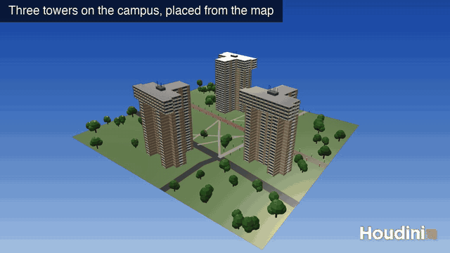
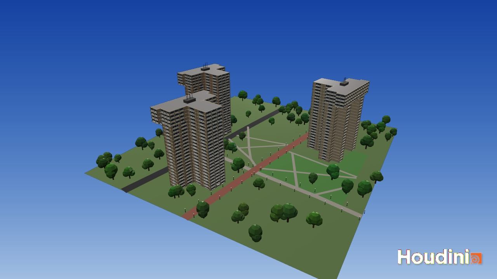
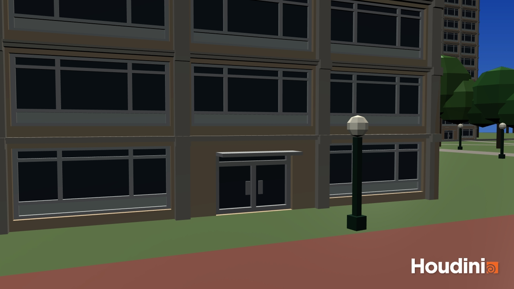
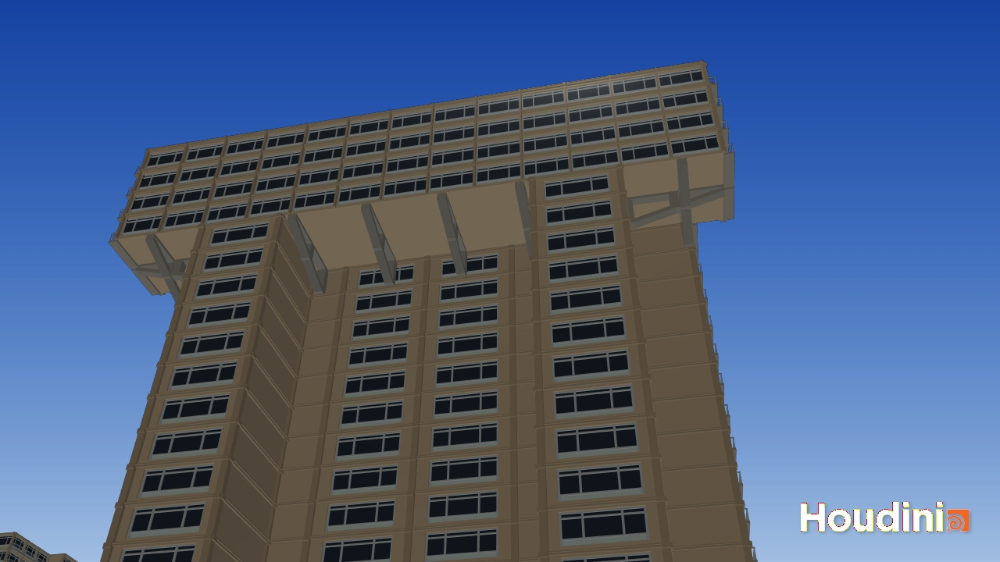
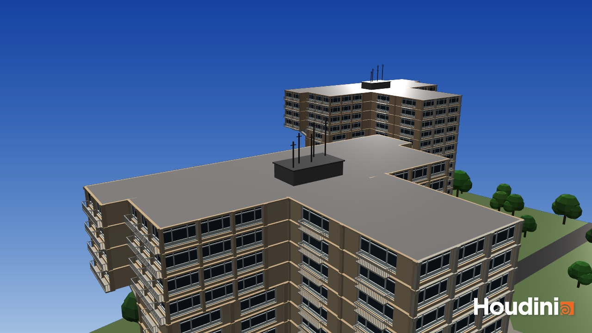

# CIS 5660 HW04 Procedural Buildings

A procedural building tool in Houdini, modeled on the three identical high-rises at the University of Pennsylvania: Harnwell, Harrison and Rodin College Houses. A single embedded HDA builds the tower from a list of stacked blocks and a set of control nodes, and three copies of it stand on a campus laid out from a map.

The Houdini file is [`buildings.hipnc`](buildings.hipnc) with HDA embedded.

## Demo Video

Click the animation for the full-resolution video ([`img/tool_demo.mp4`](img/tool_demo.mp4), 28 seconds).

## Reference Buildings

The three towers share one design, a 24-floor tower ([Penn Facilities](https://facilities.upenn.edu/maps/locations/harnwell-college-house)) that Penn calls "skyscraper sisters" ([Harrison College House history](https://harrison.house.upenn.edu/history)). They differ mainly in wall color, so the same tool builds any of them.

| Stem end and side wall | Crown overhanging the long wall |
| --- | --- |
|  |  |
| Photo: © Lester Ali via CTBUH | Photo: © Lester Ali via CTBUH |

The features taken from these photos:

- A T-shaped plan of a long bar and a narrower stem
- Vertical strips of windows in tan walls
- A concrete grid on the stem end
- Glazed top floors that overhang the wall below
- Antenna masts on the roof

## How the Tool Works

Open `/obj/box1` for the towers and `/obj/campus` for the surroundings. Each model has a yellow `_CTRL` Null holding its parameters, and these sit outside the HDA, so they can be changed without unlocking it. The finished models plug into labeled inputs on the `building` node, which cuts its openings to match them.

### Part 1: Box Stacking

The `building` node stacks a list of boxes with a For-Each loop. Each block also has **Offset X**, **Offset Z**, **Stack on Previous** and **Base Height**, because a T-shaped plan needs blocks standing side by side. Stacking stays on by default, so a new node behaves like a plain box stacker.

### Part 2: Windows, Doors and Balconies

| Control | Width and height | Other parameters |
| --- | --- | --- |
| `window_CTRL` | Width, Height | Recess, Frame Thickness, Panes, Spandrel, Transom Bar |
| `door_CTRL` | Width, Height | Recess, Double Doors, Canopy, Canopy Depth |
| `balcony_CTRL` | Width, Railing Height | Depth, Railing Type (glass, bars or solid) |

Inside the HDA, `facade_cells` splits each block's walls into floors and bays, cuts an opening for each model, and marks where each one goes. It also removes walls hidden between touching blocks. Openings too big for their bay shrink to fit.

The real towers have no balconies, so these are an addition to meet the assignment. They go on every window of the west and east walls above the ground floor, and the **Balconies** toggle turns them off for the accurate look.

### Part 3: Pillars and Borders

`pillar_CTRL` and `border_CTRL` drive pillars on every bay line and a border along every floor. On the stem end they are bare concrete, matching the grid in the reference photos. On other walls they use a darker shade of the wall color, as an interpretation of the panel seams.

### Part 4: Overhang Supports

`overhang_cells` looks for block edges with nothing directly beneath them, measures how far back the nearest wall is, and places a support there. On these towers that gives 8 brackets under the crown. No such brackets are visible in the photos, so they stand in for the structure the real building hides.

### Part 5: Chosen Features

- **More complex support logic.** Supports change type with their size: a straight post for a short drop, a solid corbel for a short reach, and an open bracket for a long reach. The limits are on the **Supports** tab. Every overhang on these towers is long, so only brackets appear by default. Raising **Short Support Limit** above 1 switches them to corbels.
- **More interface parameters.** Each block has X and Z offsets, bay spacing, window scale, and toggles for its door, balconies, pillars, borders and concrete trim.
- **A new feature type with its own placement logic.** `rooftop_CTRL` drives a mechanical penthouse with antenna masts, which goes on the largest roof at the top of the building.
- **Scene dressing.** `/obj/campus` adds ground, a lawn, roads, Locust Walk and footpaths traced from a campus map, plus lamp posts along the walks. Trees scatter at random while keeping clear of paved ground and the towers. Each tower's position and rotation were measured from the same map, in `tower_sites`.

---

## Assignment Brief

## Project Overview
In this homework, you will continue creating procedural buildings based on the work you did in lab 06. The tutorial used for that lab and this homework can be found at [this URL](https://www.youtube.com/watch?v=uIe97023sDk&t=979s&ab_channel=SimonHoudini).

## Part 0: Setup and Planning 
### SideFX Labs 
If you didn't install SideFX Labs during lab 06, make sure you do so for this homework. You can do so at the “Labs/Packages” tab of the Houdini Launcher. Make sure that the version of Labs that you install is not newer than your overall Houdini install (e.g. if you have Houdini 21.544, don't install Labs 22.650). Use the Production version of Labs, not the Daily.

### Project Planning
Before implementing any Houdini nodes or VEX code, take some time to look at different architectural styles (realistic or fictional). Decide on two different buildings that use the architectural style you chose, and add to this README concept art or photographs of your chosen buildings, citing your sources. You will be using the techniques you practiced in Lab 06 to procedurally generate buildings modeled after the ones you selected. Your buildings should be stylistically similar enough that your tool can be used to create either one by modifying its parameters.

Do make sure that what you choose is manageable given your knowledge Houdini and what is taught in the tutorial. Of course, you’re welcome to adapt the setup to support additional logic/features to match your style, and particularly complex additions could merit extra credit :) On the other hand, if you’re newer to Houdini and want to stick relatively close to the tutorial, that’s okay too. Just be sure to think through what changes your chosen buildings will require (additional assets? different placement logic?) before diving into the project so you don’t bite off more than you can chew.  
Here are a few examples of possible building styles that could be a decent fit for inspiration:
CIS 5660 HW03 Procedural Building 1 
https://www.behance.net/gallery/23773965/ISOBuilding-concept-art 

https://www.artstation.com/artwork/m6xYy 

## Part 1: Box Stacking HDA
As you did in lab 06, follow the tutorial to make a simple HDA that stacks boxes on each other.  Important note about HDA creation:  
Creating an HDA saves a .hda file at the location you specify with the definition of your HDA. Be sure to submit this .hda file along with your .hip file so we can see the contents of your tool.  
Alternatively, when you save your HDA you can choose the “Embedded in HIP File” option (rather than specifying the path), and the hda definition will be automatically embedded in your hip file (and no additional files will be needed with submission).  

## Part 2: Add Details
Next, Simon adds details to the boxes to create floors by refining the shape and adding details like windows, doors, and balconies.  
Create your own models for windows, doors, and balconies based on your chosen style using Houdini. For each of the three types, create a Null “control” node with parameters that affect your window/door/balcony output (similar to how we made a control node for the jellyfish).  
You should have parameters to drive the width and height of the doors, windows, and balconies, as well as at least one other parameter of your choosing on each one (ex: double vs single doors, windows with and without shutters, and type of balcony railing). Apart from that, you can go as simple or complex as you like!  
Then follow Simon’s setup to integrate your windows, doors, and balconies into your buildings.  

## Part 3: Pillars and Border
Continue following the tutorial to add pillars and borders to each floor. Depending on your chosen style, your building may not make use of pillars. In this case, still use the technique shown to add horizontally-instanced elements of some kind to your building.

## Part 4: Supports
Continue following the tutorial to add supports to floors that overhang other floors.  

## Part 5: Feature of your choice
Throughout the tutorial, Simon mentions ways you could extend his project setup. Implement any of his suggestions: 
- More complex logic for creating supports (handle different length supports differently) Add more parameters to the user interface (for example, x and z offset options) UV and shade your models 
- Add a “manual node” where users can control detail placement manually 
- Add additional types of feature models (like fire escapes or chimneys). Note that, depending on what you choose, you might need to add new logic to integrate them into your building (ex: chimneys go on top instead of being chained on the side, fire escapes should be on one side of the building and go all the way down). We’ll award more extra credit accordingly.  
- Add some flair to your scene by dressing together multiple buildings or additional procedural props or background elements 

## Extra Credit
Take some time to make your building demo-reel worthy, and render it with materials, a background, and lighting!

## Submission
Update your README with 
A description of your project 
A video of your building tool in action 
Create a pull request to this repository 
Submit your Houdini file to Canvas along with a link to your pull request 
IMPORTANT NOTE: make sure your HDA is either embedded in the HIP file or included with your submission (see the instructions under “Part 1: Box Stacking HDA” for additional details).
