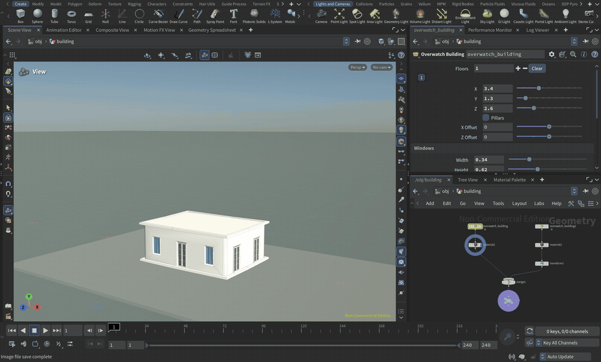
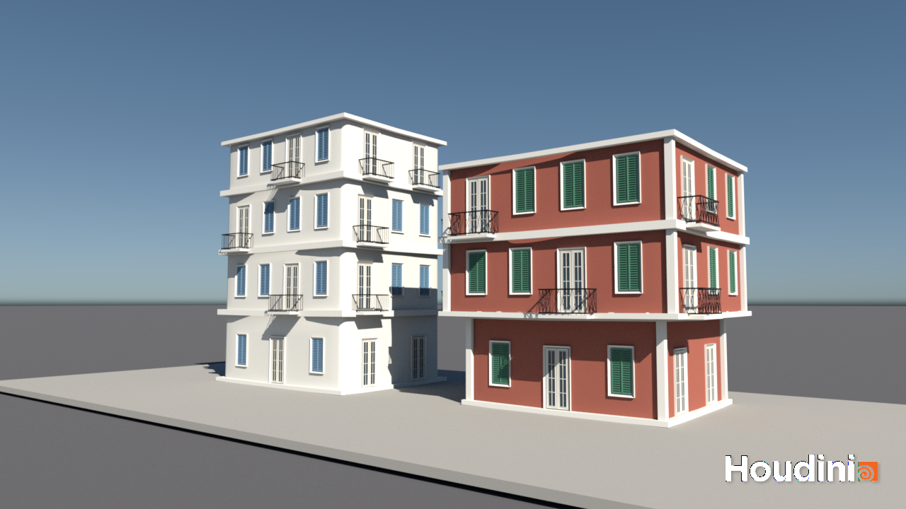
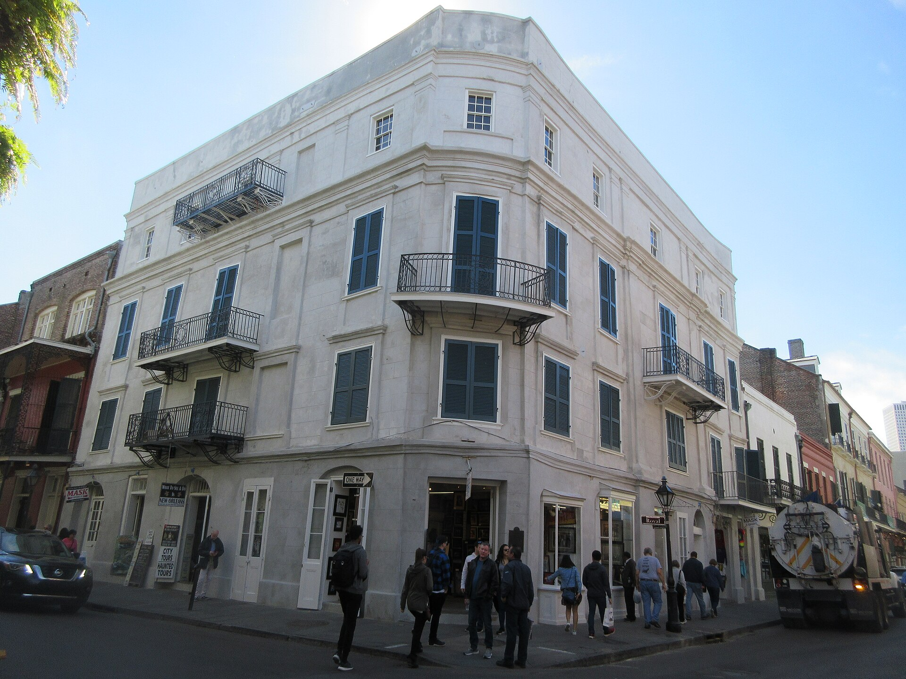
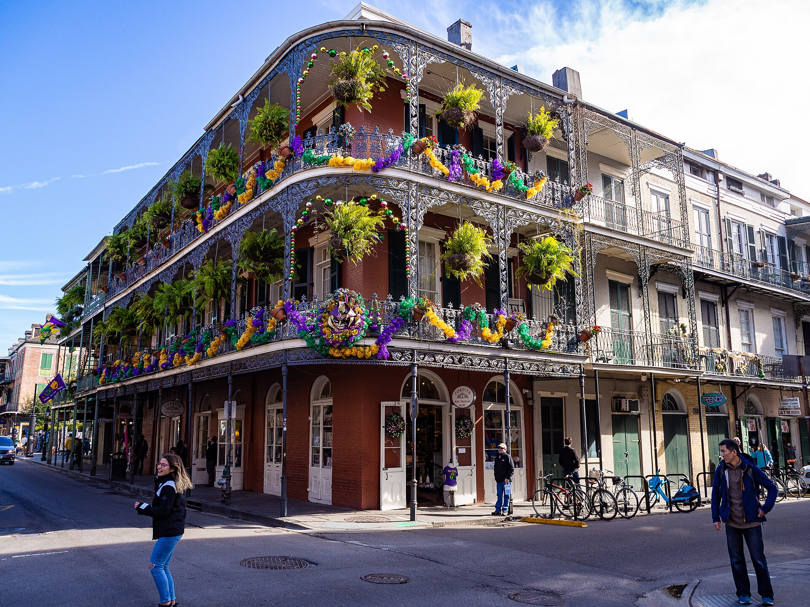
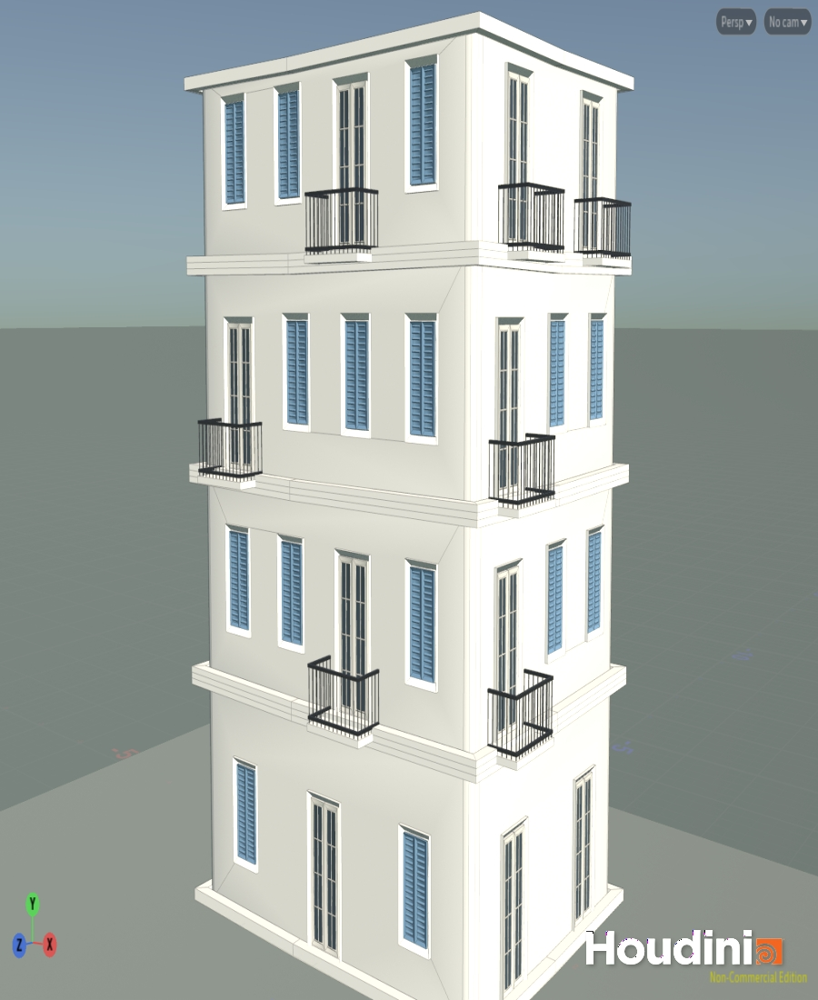
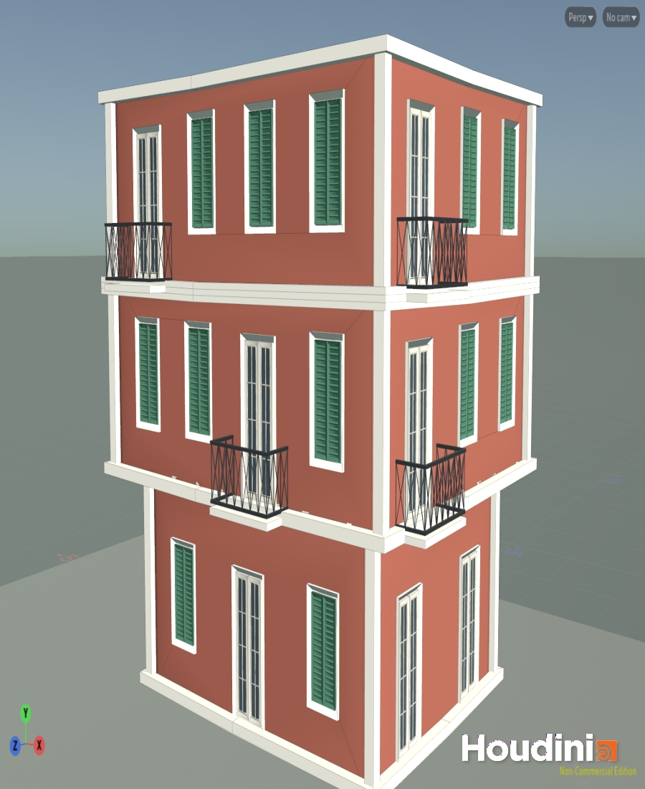
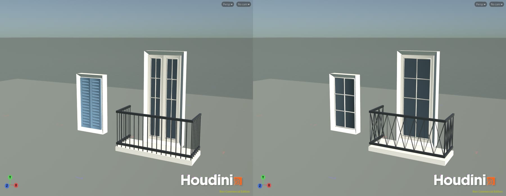
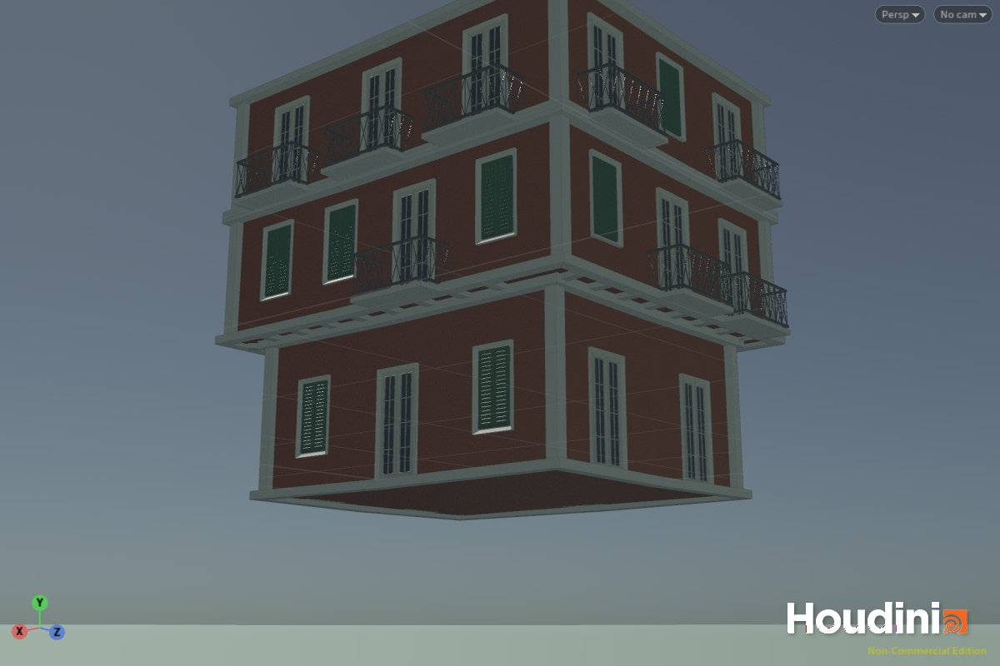

# HW 4: Procedural Buildings

Ximing Luo, CIS 5660

A building tool made in Houdini by following the Simon Houdini tutorial at https://www.youtube.com/watch?v=uIe97023sDk. Each floor is a box in a multiparm, the boxes are stacked in a feedback loop, and every floor gets windows, doors, balconies, pillars, borders and support beams. The style is the French Quarter in New Orleans.

## References

Both buildings stand at the corner of Royal Street and St Peter Street. They share shuttered windows, French doors, iron balconies and cornice bands, so one tool can make either of them by changing its parameters.

**Pedesclaux Lemonnier House, 640 Royal Street.** Four plain stucco floors with blue shutters and small wrought iron balconies.

Photo by Infrogmation of New Orleans, Creative Commons Attribution ShareAlike 4.0, from https://commons.wikimedia.org/wiki/File:St_Peter_and_Royal_Street_New_Orleans_28th_Jan_2019_Pedesclaux-Lemonnier_House_Restored.jpg

**LaBranche House, 700 Royal Street.** Three brick floors with green shutters and cast iron galleries that hang over the sidewalk.

Photo by bvi4092, Creative Commons Attribution 2.0, from https://commons.wikimedia.org/wiki/File:An_old_building_in_the_French_Quarter_-_New_Orleans,_USA_-_LaBranche_House_at_Royal_%26_St_Peter_Streets.jpg

These are the two versions made with the tool. The first has four flush floors and plain bar railings. The second has upper floors that hang over the ground floor, lattice railings and corner pillars.

## Parts

**Box stacking.** The HDA has a Floors multiparm with a tab for each floor. A for loop with feedback makes one box per floor, and a match size node sets it on top of the floors below.

**Windows, doors and balconies.** The three models are built from boxes, poly extrudes and swept lines. Each one has a control null. The window has width, height and shutters. The door has width, height and single or double leaves. The balcony has width, railing height and railing type. Every model gets an ID and a bounding box, a chain node places them along the bottom edge of each wall, and a boolean cuts the bounding boxes out of the wall. Balconies are removed on the first floor.

**Pillars and borders.** A pillar is copied to the corners of a floor when its Pillars toggle is on. The borders are the top and bottom edges of each floor swept with a small rectangle.

**Supports.** The bottom of each floor is cut by the top of the floor below, which leaves only the part that hangs over. Points on the inner edge are rayed to the outer edge and connected into beams.

**Offsets.** Each floor has an X Offset and a Z Offset, which was one of the ideas at the end of the tutorial. Shifting a floor makes an overhang and the supports follow it.

## Extra credit

The buildings have materials for the walls, trim, shutters, doors, glass and iron. The scene has a sidewalk, a street, a sky and a sun, and the second picture on this page is a Karma render.
