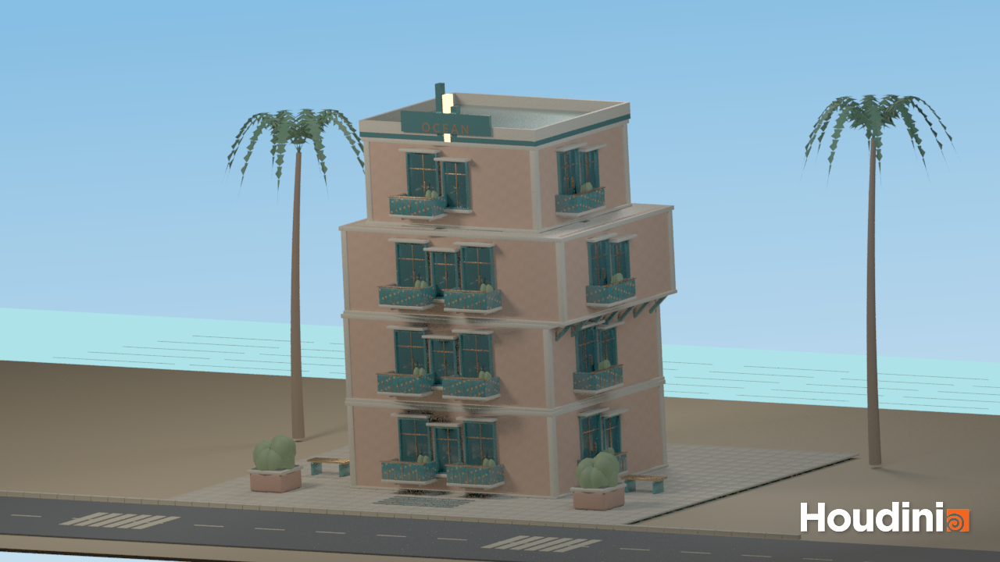
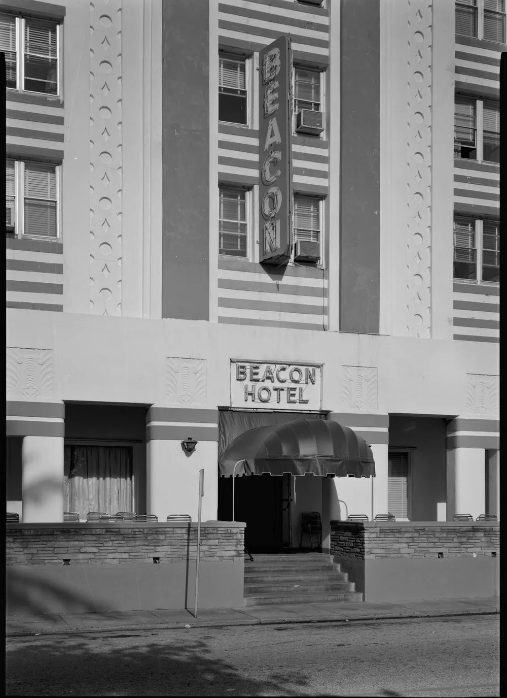
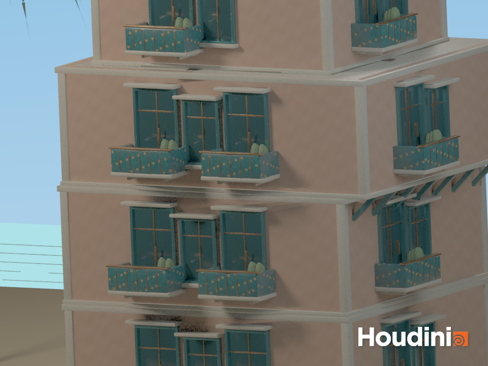

# CIS 5660 HW04 Procedural Buildings

## Deco / Offset

Deco / Offset explores how a repeated facade can hold together as the floors behind it change shape and position. Built in Houdini, the tool draws on the Colony and Beacon hotels in Miami Beach, combining pale horizontal trim with teal frames, solid balcony panels and a stepped roof detail.

## Building tool demo

[Building tool demo](demo/tool_demo.mp4)

## Architectural direction

| Colony Hotel — Miami Beach                                   | Beacon Hotel — Miami Beach                                   |
| ------------------------------------------------------------ | ------------------------------------------------------------ |
|    |  |
| [Architectural description — Miami Design Preservation League](https://mdpl.org/building/colony-hotel/) · [Illustration source — Colony Hotel](https://www.colonymiami.com/) | [Photograph source — Beacon Hotel](https://beaconsouthbeach.com/) · Historic American Buildings Survey / Library of Congress |

I used the Colony's long facade bands and projecting window shades to guide the horizontal details, while its vertical sign informed the rooftop accent. The Beacon offered another example of how repeated windows and small surface details give a simple building volume a recognizable character.

## Building and facade controls

A floor multiparm controls each level’s dimensions and X/Z position. A feedback loop stacks the floors and updates their heights automatically.

Custom windows, doors and balconies are placed using Chain and Copy to Points. Shared IDs match each model to its Boolean cutter. Spacing, repeating patterns and seeded random layouts are adjustable.

| Component | Null controller   | Controls                        |
| --------- | ----------------- | ------------------------------- |
| Window    | `WINDOW_CONTROL`  | Width, height, frame depth      |
| Door      | `DOOR_CONTROL`    | Width, height, frame depth      |
| Balcony   | `BALCONY_CONTROL` | Width, height, projection depth |

Window and door openings follow their model dimensions. Pillars, floor borders and roof details have separate toggles.

## Materials and setting

Peach stucco, terrazzo trim, teal mosaic balconies and brass details define the facade. Planters, rooftop lettering, tiled paving and benches add detail, while palms, a shoreline and a road create the coastal setting.

Procedural texture maps are embedded in the HDA. World-aligned UVs maintain consistent texture scale as the building changes size.

## Floor offsets and supports

Each floor has an independent, absolute X/Z offset. Its facade, slabs and pillars follow its position, while the roof follows the top floor.

The tool compares adjacent footprints and adds diagonal braces beneath overhangs. Brace spacing and visibility are adjustable, and their drop responds to the overhang length and lower floor height. Supports are generated after stacking so they do not affect floor placement.

