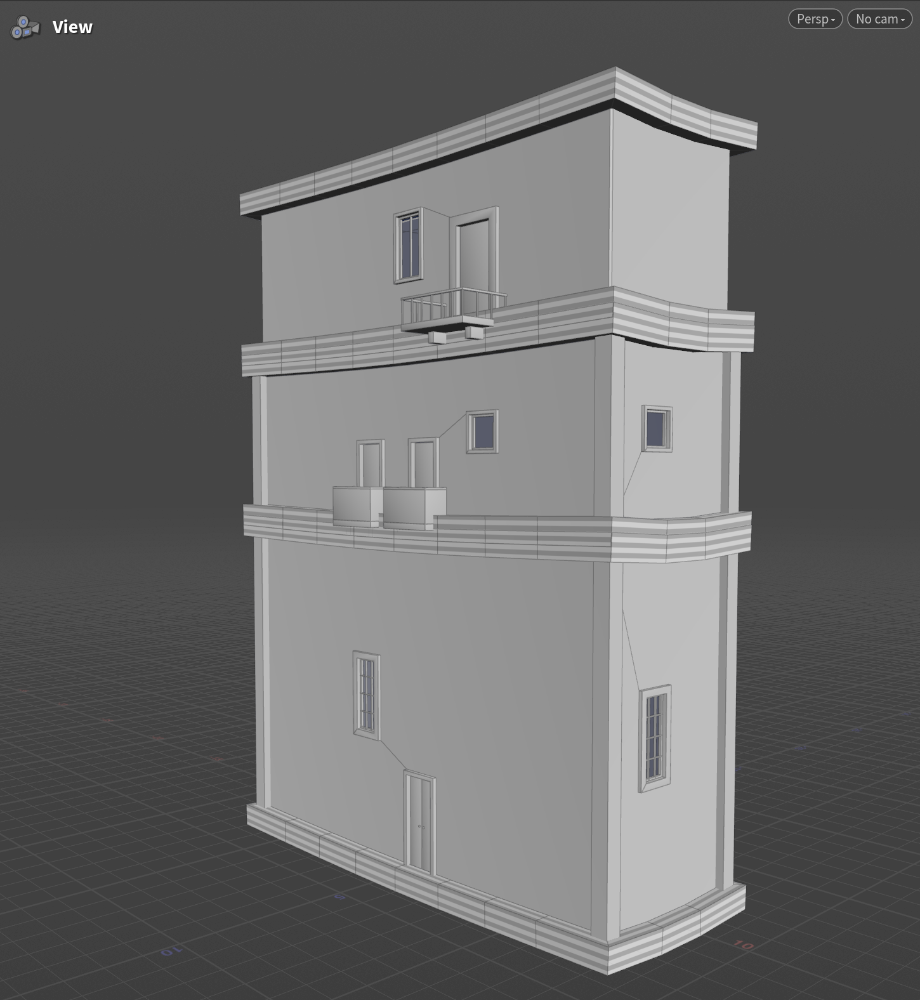
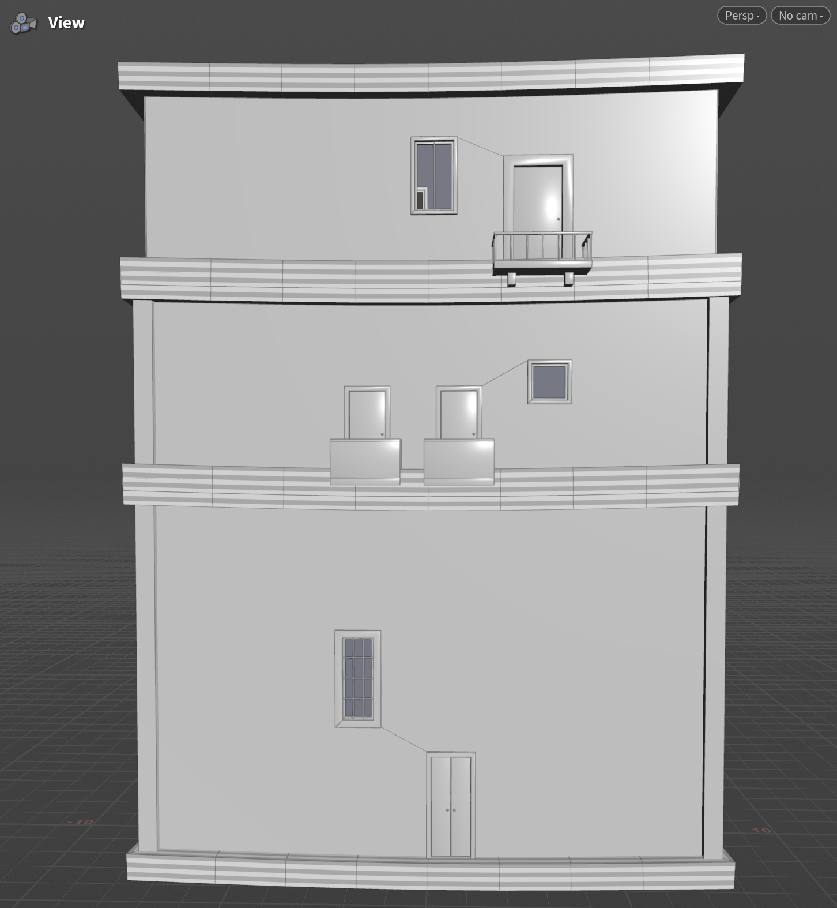
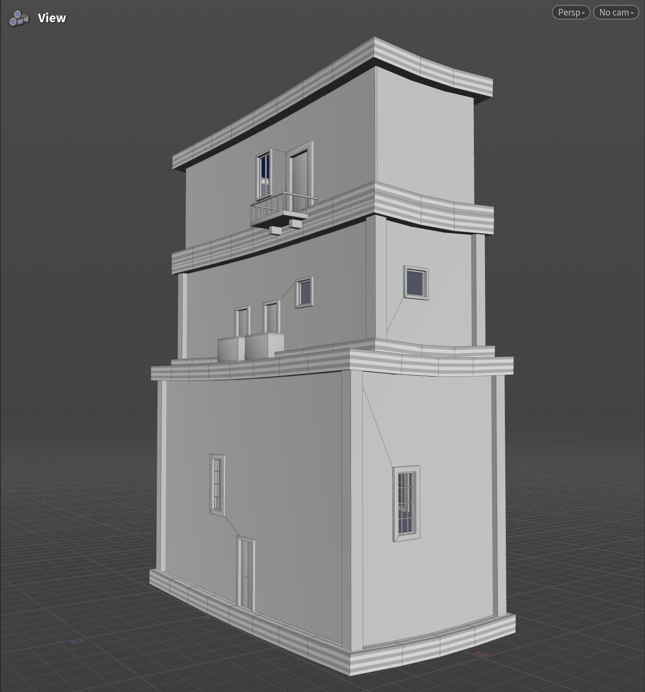
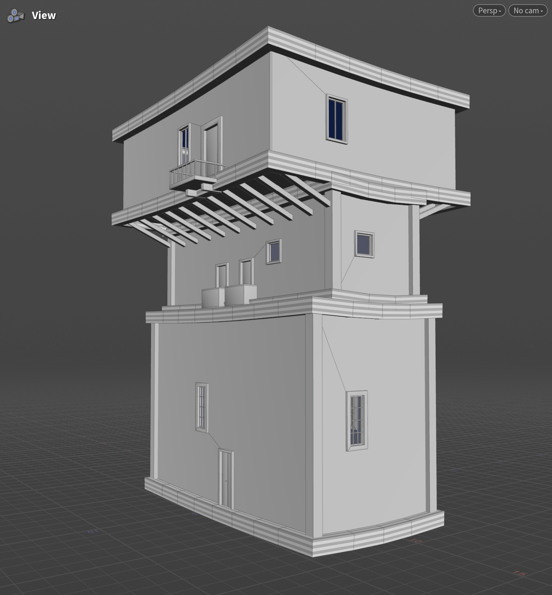
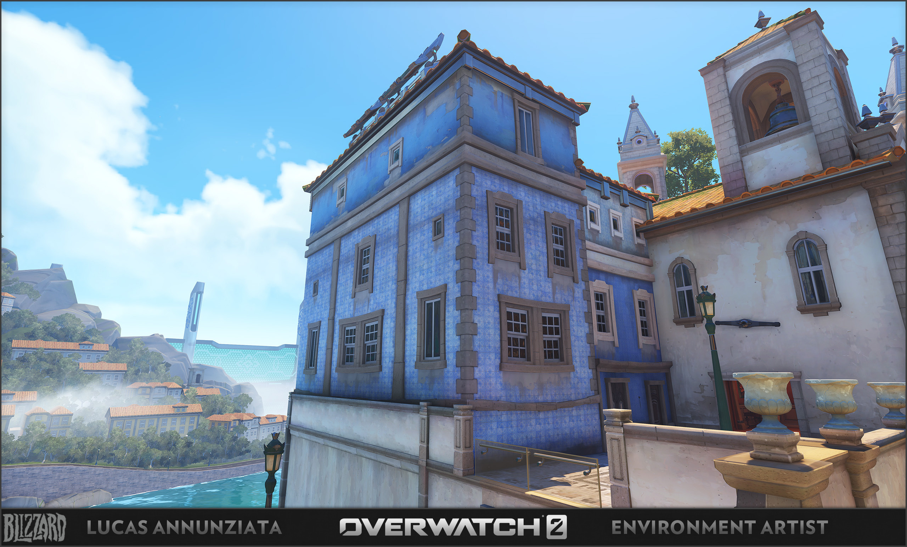
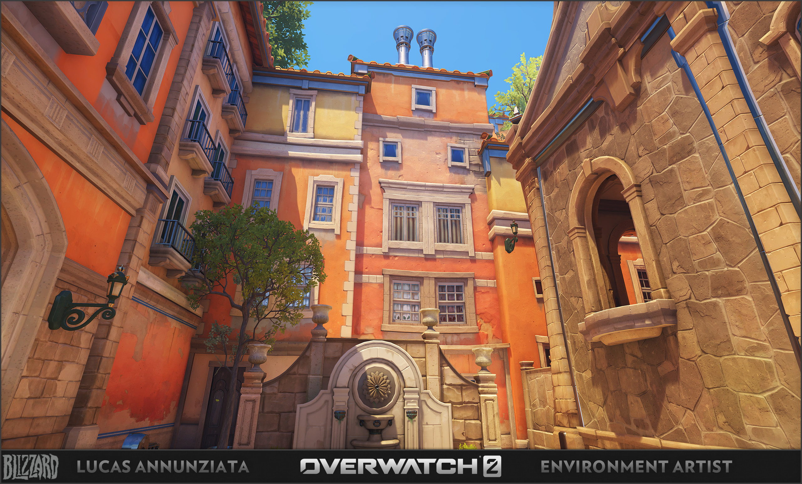

# CIS 5660 HW04 Procedural Buildings - Ziqiu Wang

In this project, I built a Houdini tool for creating procedural buildings with customizable windows, doors, and balconies.

<table>
  <tr>
    <td align="center" width="50%">
      
       <strong>Best View</strong>
    </td>
    <td align="center" width="50%">
      
       <strong>Front View</strong>
    </td>
  </tr>
  <tr>
    <td align="center" width="50%">
      
       <strong>Variation 1</strong>
    </td>
    <td align="center" width="50%">
      
       <strong>Variation 2</strong>
    </td>
  </tr>
</table>

## Video Link
https://www.youtube.com/watch?v=oAB2jTpMUJU

## References

This project is inspired by the [Overwatch 2 - Protugal](https://lucasannunziata.com/projects/GerQgV) project by Lucas Annunziata.

## Details

The tool allows the user to change various parameters of each floor:
- Floor size (width, height, depth).
- Togglable pillars at the corners.
- Windows: width, height, border thickness, and numbers of vertical and horizontal bars.
- Doors: width, height, frame thickness, and togglable single/double door.
- Balconies: width, railing height, depth (how far it extends into the air), togglable bar railing vs. solid railing, and numbers of front and side bars if bar railing is selected.

Each floor also comes with borders around its top and bottom planes. The tool also adds supports if a floor is longer in the z-direction than the floor directly below it.

For Part 5 of the assignment, I implemented a more complex logic for creating supports. Specifically, I improved Simon's method to make sure that the normals are always calculated correctly regardless of the sizes of the floors, and I also made sure that pillars are added only within the width of the lower floor so that no pillar floats in midair beyond that width. Additionally, I added more parameters to the user interface as described above. 
