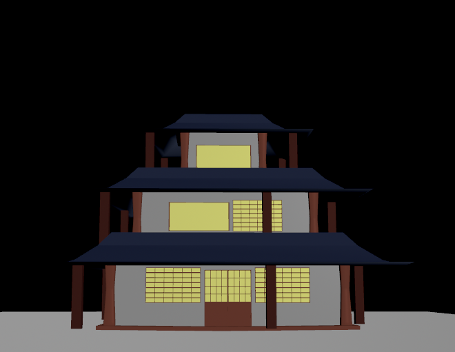
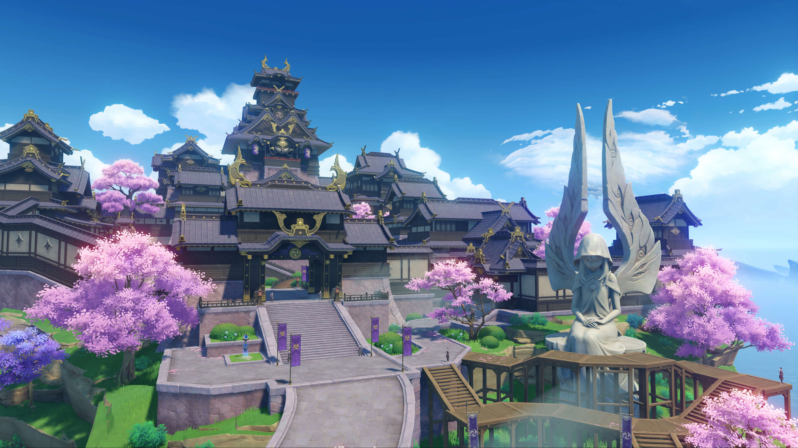
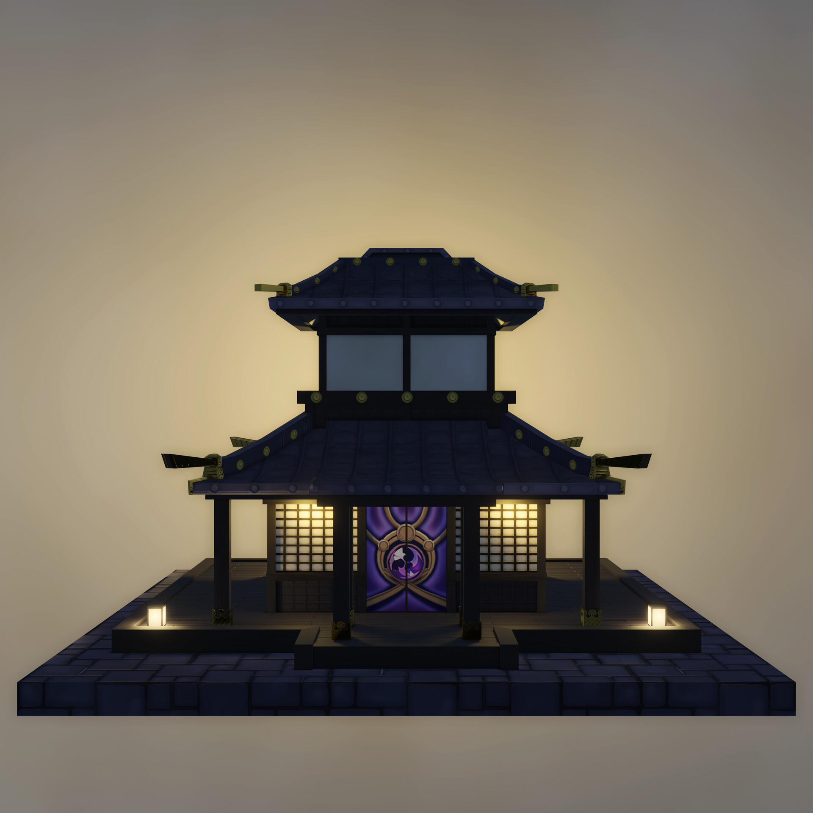
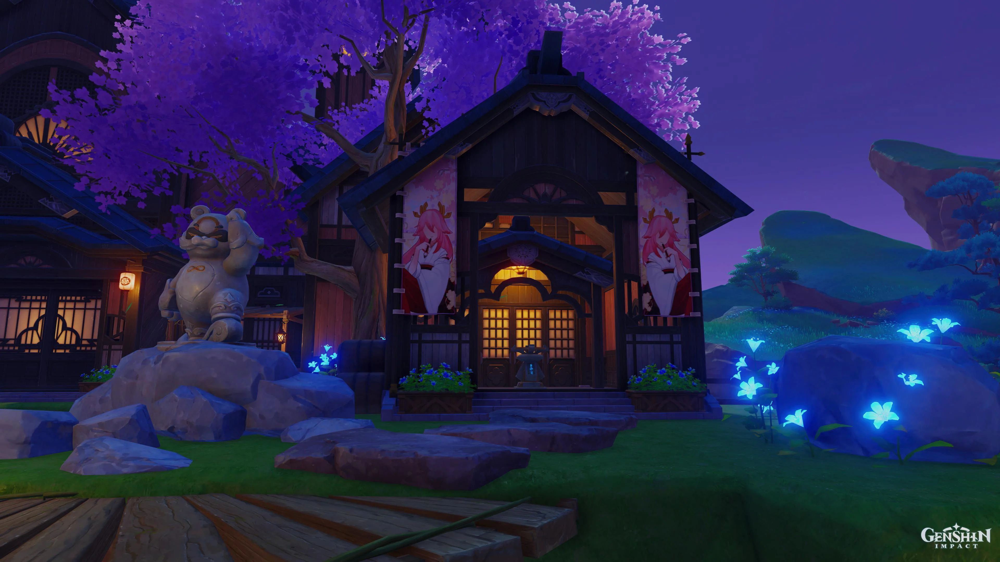

# CIS 5660 HW04 Procedural Buildings

<video width="800" controls>
  <source src="images/demo.mp4" type="video/mp4">
</video>

## References

I took inspiration from the Inazuma buildings found in Genshin Impact

Rather than attempt to recreate everything in the region, I focused on one building model and attempted to replicate a structure similar to it that we could procedurally modify. 

I also didn't like the door that was shown there, so I referenced this one instead.

##Implementation

I modeled the doors and windows in Houdini and added controls for their width and height, along with a single or double door option. The assets are placed along each wall, and I added logic to center them so the leftover space is more balanced on both sides. Doors are also limited to the first floor.

For the other details, I added pillars with a profile ramp so they can taper inward in the middle, as well as borders around the floors. I also made a custom roof profile that slopes outward and turns up slightly at the ends to get closer to the style of my references. The roof-edge supports have adjustable spacing and extend down toward the floor below.

The custom roofs and roof edge support placement are the main ways I extended the tutorial setup. I also added separate colors for the walls, frames, and roofs, plus darker window panes to make the window details easier to see.

Submit your Houdini file to Canvas along with a link to your pull request 
IMPORTANT NOTE: make sure your HDA is either embedded in the HIP file or included with your submission (see the instructions under “Part 1: Box Stacking HDA” for additional details).
