# Procedural Buildings: Jiangnan Water Town

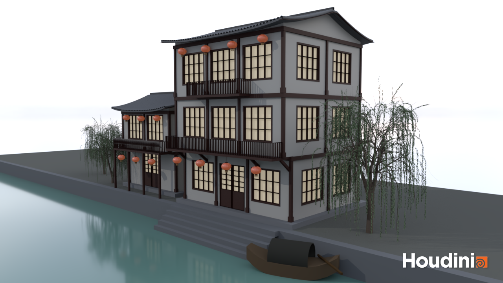

*The two-floor teahouse and three-floor restaurant on a stone bank by the canal, with willows, red lanterns and a covered boat.*

A Houdini HDA that generates Jiangnan-style riverside buildings by stacking floors. One tool makes both a two-floor **riverside teahouse (临河茶楼)** and a three-floor **restaurant (酒楼)** by changing only its parameters. The scene is dressed with willows, water and an overcast sky to make it feel like a small town.

## Demo Video

**Building tool demo** (2× speed): [images/buildingtool_demo.mp4](images/buildingtool_demo.mp4)

*Editing the `building_tool` parameters live: floors, overhang, balconies, wall type, support mode, roof and look settings.*

**Scene demo:** [images/demo.mp4](images/demo.mp4)

*Flythrough of the finished water-town scene with both buildings, willows, stone bank and boat.*

## Files / How to Open

- Open `building_final.hipnc` (Houdini 22.0). All HDAs are **embedded in the hip file**, so no separate `.hda` files are needed: `anna0::building_tool`, `anna0::lattice_window`, `anna0::lattice_panel` and `anna0::set_mat`.
- The scene is `/obj/scene`. The two buildings are `/obj/scene/teahouse` (Building A) and `/obj/scene/restaurant` (Building B), two instances of the same `building_tool` HDA with different parameters.
- Render camera: `/obj/main_cam`. Lighting: `/obj/sky` (HDRI) and `/obj/sun`.

## Features

The style stays fixed: white plaster, dark grey tiles, dark-brown timber, with red only on the lanterns. The roof type, lattice pattern and colour palette are shared, so the two buildings always read as the same town. They differ mainly in numeric parameters (floor count, floor size, overhang, balconies) plus a couple of menu switches.

The building is always built facing +Z (the river side). Doors, overhangs and balconies all assume that, and the whole building is rotated at the object level to place it in the scene.

### Building A / Building B

<table>
<tr><td align="center">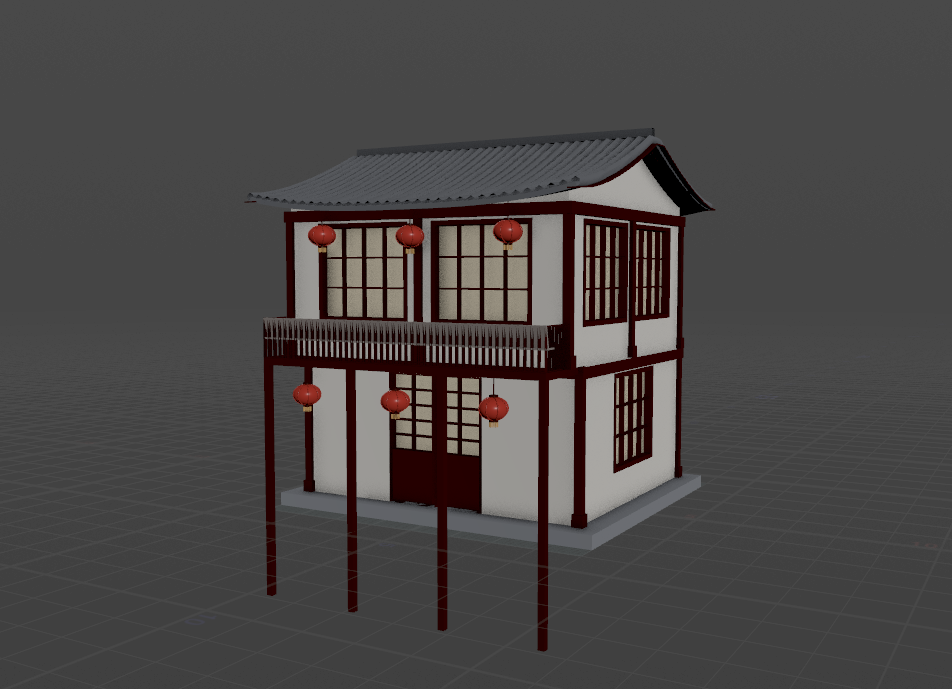</td><td align="center">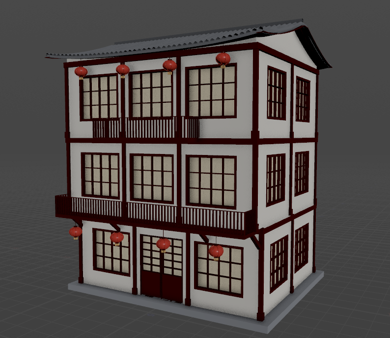</td></tr>
<tr><td align="center"><em>Building A: two-floor riverside teahouse on stilts</em></td><td align="center"><em>Building B: three-floor restaurant</em></td></tr>
</table>

*Both buildings come from the same `building_tool` HDA.*

| Parameter | Building A: Teahouse | Building B: Restaurant |
|---|---|---|
| Floors | 2 | 3 |
| Floor size (X × Y × Z) | 7 × 3.3 × 6 | 10 × 3.9 / 3.7 × 8 |
| Overhang per floor | 0, 0.6 | 0, 0.76, 0.79 |
| Balconies | Full length on floor 2 | Full length on floor 2, front section on floor 3 |
| Support mode | Auto (ends up as stilts over the water) | Brackets |
| Railing style | 美人靠 leaning seat | Straight balusters |

The teahouse is small and low, sits right on the water and leans out over it on stilts, like the Wuzhen stilt houses (A2). The restaurant is wider and taller, with stacked balconies held up by timber brackets, like the Zhouzhuang restaurants (B1, B3).

### The `building_tool` HDA

Everything is driven from one HDA. The top-level tabs (**Floors**, **Support**, **Roof**, **Look**) hold everything needed to switch between the two buildings, and the **Advanced** section holds the finer spacing and size controls.

<a href="images/building_control.png">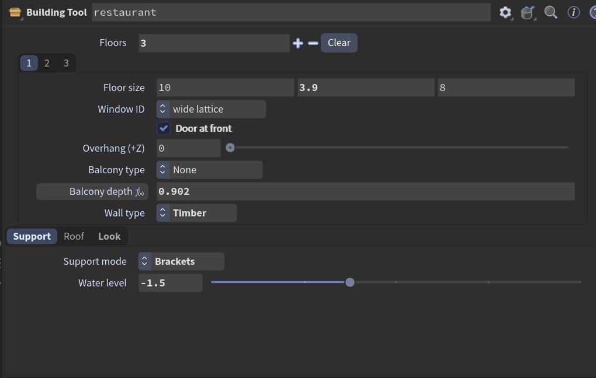</a>

*Main `building_tool` panel: floor count, per-floor size, window type, door, overhang, balcony and wall type, plus support mode and water level.*

<a href="images/building_adv_control.png">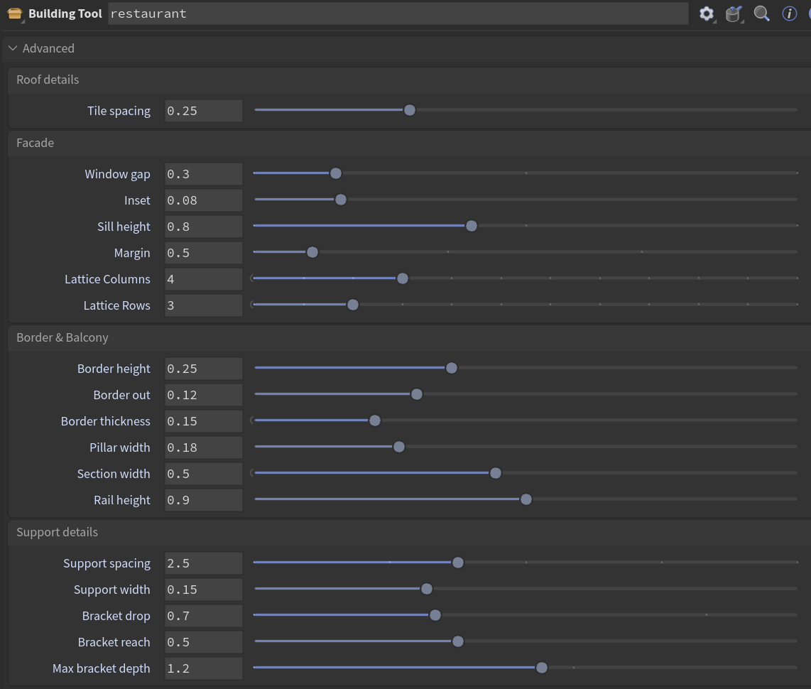</a>

*Advanced tab: fine controls for tile spacing, window spacing and lattice, borders and pillars, balcony width and supports.*

<table>
<tr><td align="center">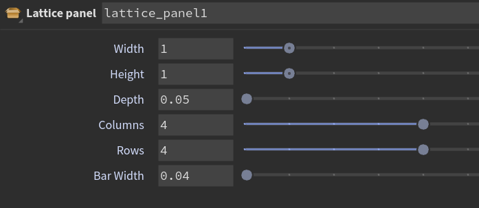</td><td align="center">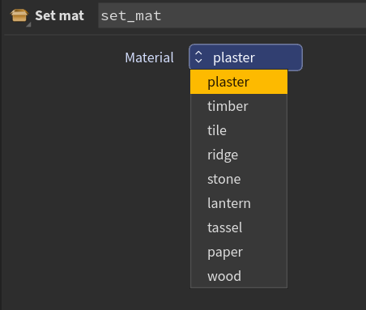</td></tr>
<tr><td align="center"><em><code>lattice_panel</code>: shared by windows, doors and railings</em></td><td align="center"><em><code>set_mat</code>: material tags</em></td></tr>
</table>

*Two small helper HDAs used inside `building_tool`.*

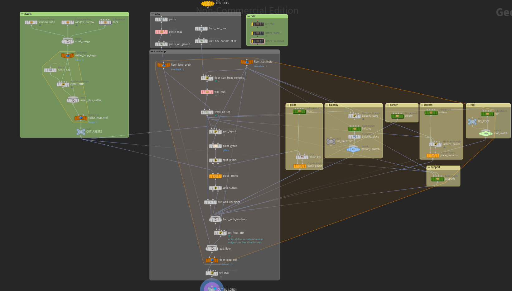

*Inside the `building_tool` HDA.*

### Box Stacking (Part 1)

Following the tutorial, the building is a stack of boxes driven by a **Floors** multiparm. Each floor box is placed on top of the one below it, and every floor has its own controls on the **Floors** tab:

- **Floor size:** width, height and depth of the floor.
- **Window ID:** wide or narrow lattice window.
- **Door at front:** puts a door on the +Z side (normally only the ground floor).
- **Overhang (+Z):** pushes the floor out over the one below, which is what makes the upper floors lean over the river.
- **Balcony type:** none, front section or full length, plus **Balcony depth**.
- **Wall type:** plaster or timber infill.

Each floor's primitives carry an `i@floor` attribute, so later steps (windows, borders, supports, materials) know which floor they belong to.

### Windows, Doors, Balconies (Part 2)

Windows, doors and balconies are modelled in Houdini and built inside the building HDA instead of being brought in with Object Merge. That way the teahouse and the restaurant can use different asset settings at the same time. Each asset has its own CTRL null with width, height and depth, plus at least one extra control. The lattice itself comes from one small `lattice_panel` HDA that windows, doors and railings all share, so the grid pattern matches everywhere.

Assets are placed on the floor boxes following the tutorial: points are spread along each wall using **Window gap** and **Margin**, the door takes a window's place when **Door at front** is on, and the assets are copied onto the points.

**Windows:** a timber frame around a paper-lattice panel. **Lattice Columns** and **Lattice Rows** set the grid, and there are wide and narrow variants. **Inset** pushes the window into the wall and **Sill height** sets how high it sits.

<table>
<tr><td align="center">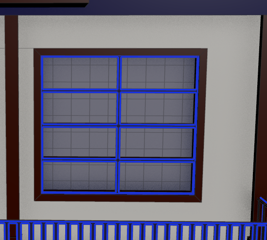</td><td align="center">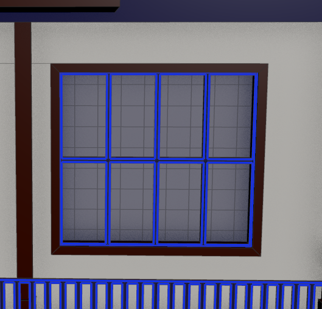</td><td align="center">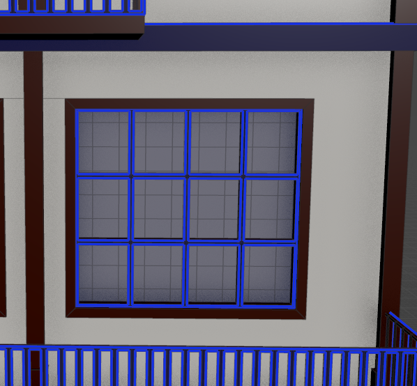</td><td align="center">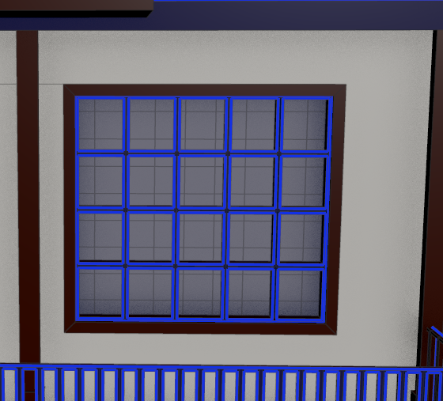</td></tr>
<tr><td align="center"><em>2×4</em></td><td align="center"><em>4×2</em></td><td align="center"><em>4×3</em></td><td align="center"><em>5×4</em></td></tr>
</table>

**Doors:** traditional lattice doors (隔扇门). **Door leaves** splits the opening into 2, 4 or 6 panels. Each leaf's width is the door width divided by the number of leaves, and **Panel ratio** sets how much of each leaf is lattice and how much is solid board.

<table>
<tr><td align="center">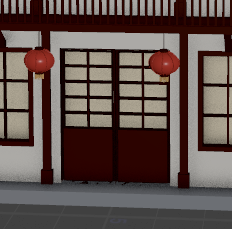</td><td align="center">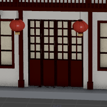</td><td align="center">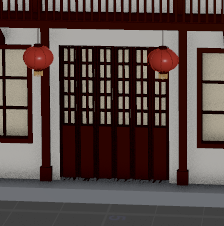</td></tr>
<tr><td align="center"><em>2 leaves</em></td><td align="center"><em>4 leaves</em></td><td align="center"><em>6 leaves</em></td></tr>
</table>

**Balconies:** a timber slab with a railing along the front and sides. The CTRL has **Rail height**, **Slab thickness**, **Bar width** and **Baluster gap**, and the balcony width and depth come from the floor settings. **Railing style** switches between straight balusters and a 美人靠 (Meirenkao) leaning seat, the bench with a slanted back seen along Jiangnan waterfronts.

<table>
<tr><td align="center">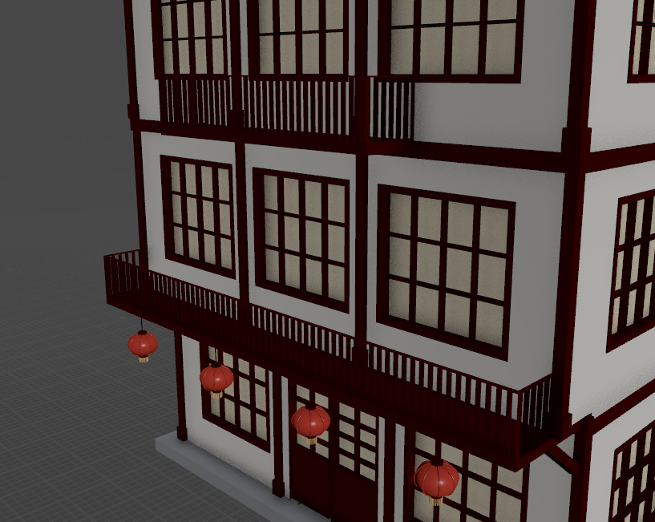</td><td align="center">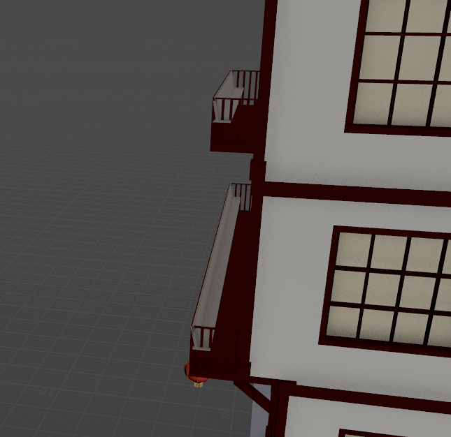</td><td align="center">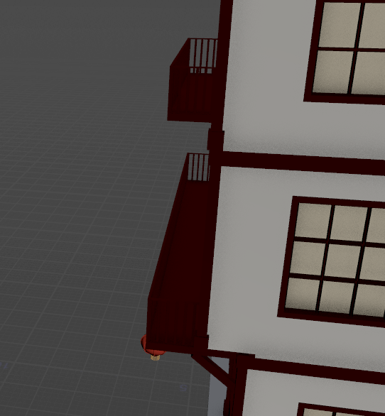</td></tr>
<tr><td align="center"><em>Full wrap-around balcony</em></td><td align="center"><em>美人靠 Meirenkao leaning seat. The seat is recoloured lighter here so it is easy to see; in the building it uses the timber colour.</em></td><td align="center"><em>Straight balusters</em></td></tr>
</table>

<table>
<tr><td align="center">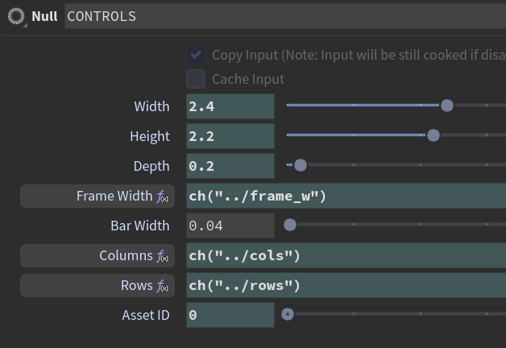</td><td align="center">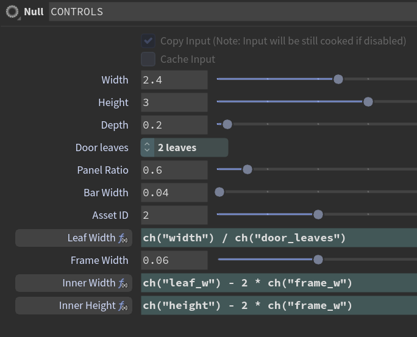</td><td align="center">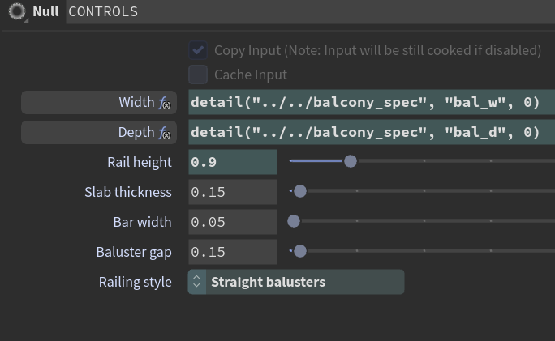</td></tr>
<tr><td align="center"><em>Window CTRL</em></td><td align="center"><em>Door CTRL</em></td><td align="center"><em>Balcony CTRL</em></td></tr>
</table>

### Pillars and Borders (Part 3)

In this style the "pillars" are the exposed timber frame. Following the tutorial's pillar setup, posts are copied along each floor's edges and corners, and a border beam runs around the top of every floor. **Pillar width**, **Border height**, **Border out** and **Border thickness** control them. The plaster or timber infill sits between the posts, which gives the dark-framed white walls of the reference houses.

### Supports (Part 4)

Whenever a floor overhangs the one below it, supports are added under the overhang. **Support mode** has three options:

- **Brackets:** diagonal timber braces from the wall below up to the overhang. **Bracket drop** and **Bracket reach** set their shape.
- **Stilts:** vertical posts from the overhang straight down to **Water level**, like the stilt houses over the canal.
- **Auto:** uses brackets when the overhang is shallow enough (up to **Max bracket depth**) and switches to stilts when it is deeper or sits over the water.

**Support spacing** and **Support width** control how many supports there are and how thick they are.

<table>
<tr><td align="center">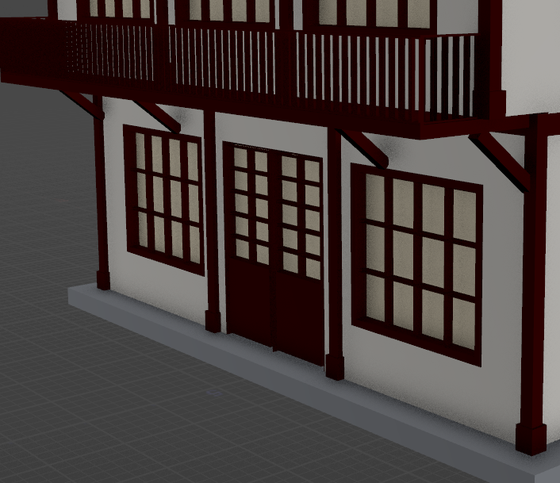</td><td align="center">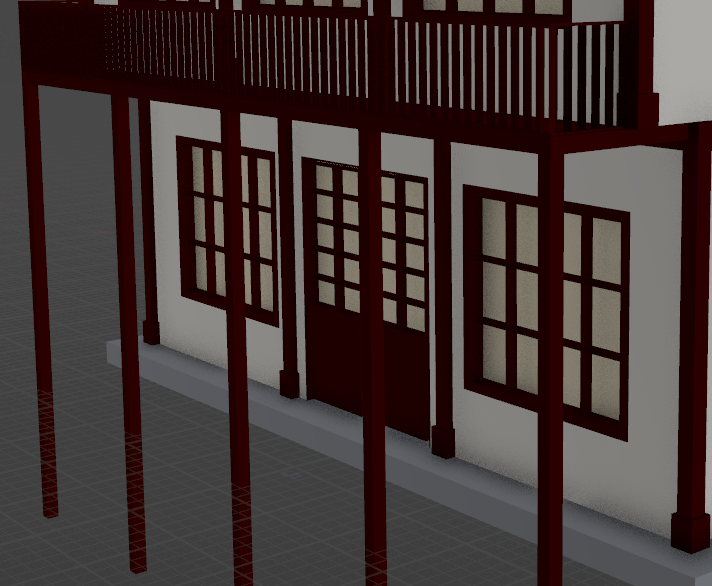</td></tr>
<tr><td align="center"><em>Brackets under the overhang</em></td><td align="center"><em>Stilts down to the water level</em></td></tr>
</table>

### Roof and Scene (Part 5)

For the extra feature I added a roof, lanterns and materials, and dressed a small canal scene.

- **Roof:** a 悬山 (overhanging gable) roof, the most common roof on Jiangnan houses. **Eave depth** and **Gable overhang** set how far it reaches past the walls, **Roof height** and **Roof sag** shape the slope, and **Eave curl** lifts the ends of the eaves. Rows of tiles are laid along the slope with **Tile spacing**.
- **Lanterns:** red lanterns hang under the eaves and balconies, spaced by **Lantern spacing** with an adjustable **Lantern radius**. They are the only red in the palette.
- **Materials:** a `set_mat` helper HDA tags every part (plaster, timber, tile, ridge, stone, lantern, tassel, paper, wood) so materials can be assigned in one place. The plaster, timber and tile colours are on the **Look** tab.
- **Scene:** water, a stone quay with steps down to the canal, three willows and a covered boat, lit by an overcast HDRI to keep the soft, grey-blue mood of the references.

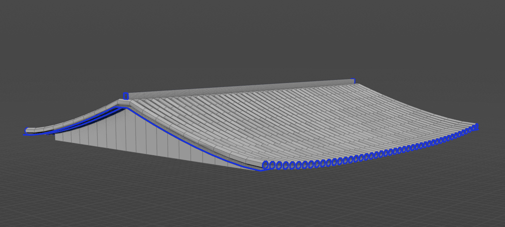

*悬山 roof with curled eaves and a tiled surface.*

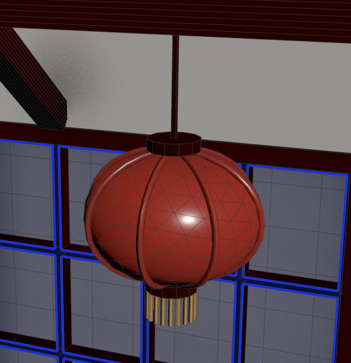

*Red lantern hung under the eaves.*

## Project Planning

### Mood Board

<a href="images/moodboard.jpg">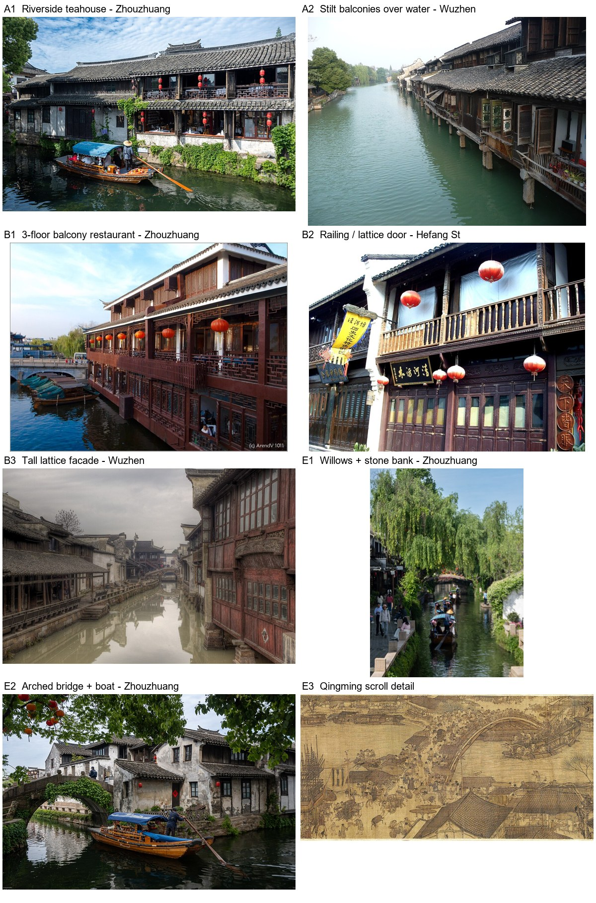</a>

*Jiangnan water town references (Zhouzhuang, Wuzhen, Hangzhou). Labels match the reference list below.*

## References

**Building A: Riverside Teahouse (临河茶楼)**
- A1, Zhouzhuang riverside teahouse: xiquinhosilva, CC BY 4.0. https://www.flickr.com/photos/7138083@N04/55459387527/
- A2, Wuzhen stilt houses with balconies over water: Immanuel Giel, CC BY-SA 4.0. https://commons.wikimedia.org/wiki/File:Canal_in_Wuzhen_01.JPG (used in https://en.wikipedia.org/wiki/Wuzhen)

**Building B: Multi-story Restaurant (酒楼)**
- B1, Zhouzhuang three-floor balcony restaurant: Arend Vermazeren, CC BY 2.0. https://www.flickr.com/photos/vermazeren/6276344627/
- B2, Hefang Street railing and lattice-door detail: jensimon7, CC BY 2.0. https://www.flickr.com/photos/jennifersimon/1209662179/
- B3, Wuzhen tall timber lattice facade: Evilbish, CC BY-SA 3.0. https://commons.wikimedia.org/wiki/File:WuzhenWaterway.jpg (used in https://zh.wikipedia.org/wiki/乌镇镇)

**Environment (小镇环境)**
- E1, Zhouzhuang willows, stone bank and bridge: xiquinhosilva, CC BY 4.0. https://www.flickr.com/photos/7138083@N04/55460369856/
- E2, Zhouzhuang arched bridge and boat: xiquinhosilva, CC BY 4.0. https://www.flickr.com/photos/7138083@N04/55460761390/
- E3, *Along the River During the Qingming Festival* (detail), Zhang Zeduan, public domain. https://en.wikipedia.org/wiki/Along_the_River_During_the_Qingming_Festival

**Third-Party Assets**
- **Willow tree model:** This work is based on "[Weeping willow tree](https://sketchfab.com/3d-models/weeping-willow-tree-48c090ce93d543cf8b19d3c6f2b6788a)" by [adam127](https://sketchfab.com/adam127) licensed under [CC-BY-4.0](http://creativecommons.org/licenses/by/4.0/)
- **Sky HDRI:** "[Kloofendal Overcast (Pure Sky)](https://polyhaven.com/a/kloofendal_overcast_puresky)" by Greg Zaal, [Poly Haven](https://polyhaven.com), CC0.

**Tutorial**
- Based on [Simon Houdini's procedural building tutorial](https://www.youtube.com/watch?v=uIe97023sDk&t=979s&ab_channel=SimonHoudini).
