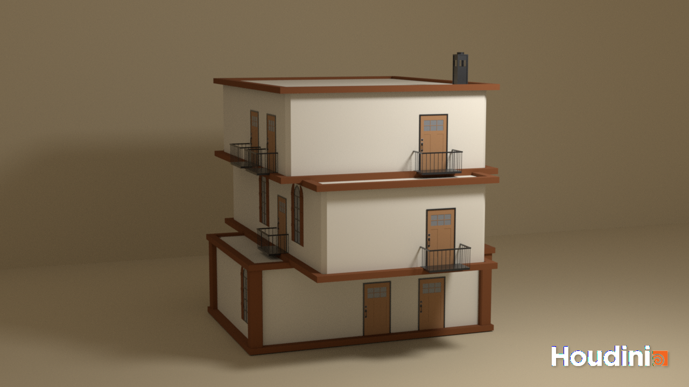

# CIS 5660 HW04 Procedural Buildings
The assignment instructions can be found [**here**](https://github.com/CIS-5660-Fall-2026/hw04-buildings/blob/main/README.md).

The video demo of the tool in action can be found [**here**](https://youtu.be/MIhxXKCO4FA). 

### Implementation Details
For the most part, I do not deviate from the [tutorial](https://youtu.be/uIe97023sDk) in the formation of my building. The only deviation is in creating holes in the building for the assets - as one of my assets (arched window) has an unconventional shape, the method of using the bounding box to subtract from the building would not leave a perfect hole behind. Thus, for that particular asset, I instead extrude it and used this extrusion to subtract with, creating a perfectly shaped hole (thank you to Nico for this solution). 

For **detail control** (i.e., windows, doors, and balconies) I added a `Null` "control" node that allows for scaling of the objects. For further window detail, I implemented shutters which, along with scaling with the windows, can be toggled on and off. 

For the feature of my choice, I added a **chimney**. It is always on the topmost level, and positioned in the corner using the level's bounds.