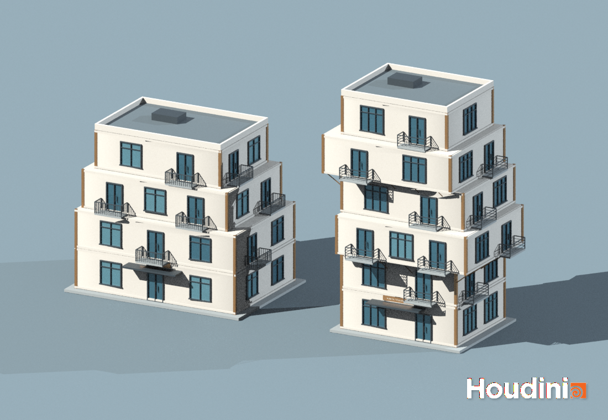
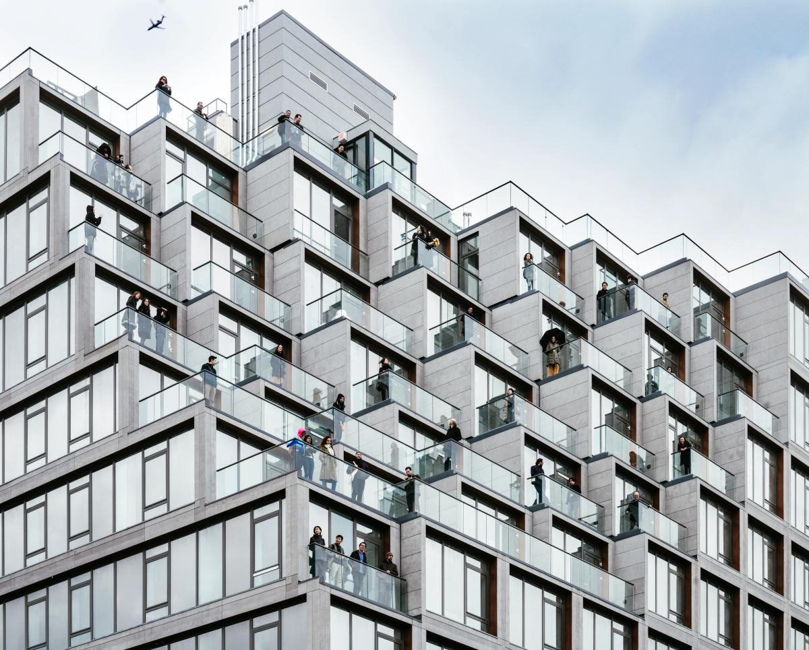
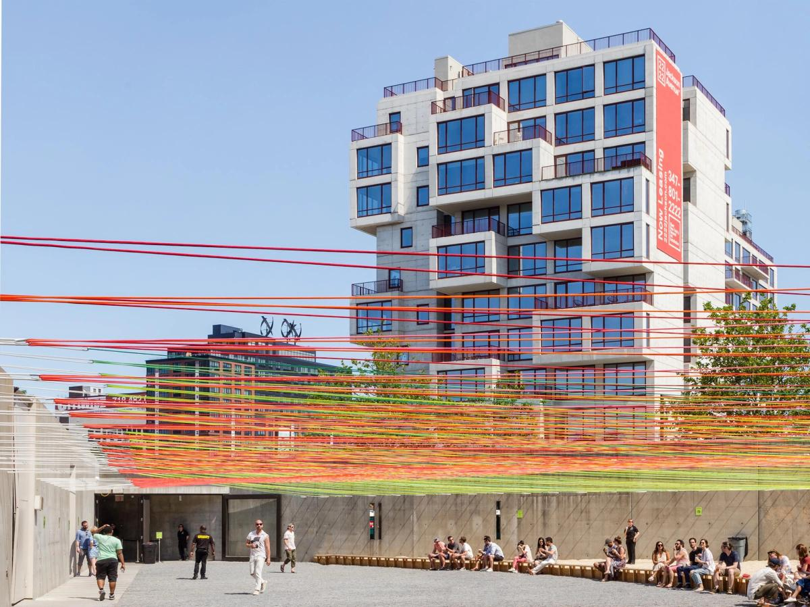

# CIS 5660 HW04 — NORTH / Residences

NORTH / Residences is a procedural apartment-building tool with two presets: a wide four-floor building with setbacks, and a narrower six-floor building with offset floors. Both use pale walls, dark window frames, blue-gray glass and bronze details.

[Houdini scene](hw04_residences.hipnc) · [Parameter demonstration video](video/tool_demo.mp4)

The silent video shows rendered changes to floor count, window and door dimensions, balcony railings, floor offsets and supports. It is a rendered parameter demonstration rather than a Houdini interface recording.

## Using the tool

Open `hw04_residences.hipnc` in Houdini. The project was made with Houdini 21.0.512 Apprentice. The building HDA and required Labs definition are embedded in the scene; no separate HDA file is needed.

Select `/obj/BUILDING_A/BUILDING_GENERATOR` or `/obj/BUILDING_B/BUILDING_GENERATOR`. The two instances use the same HDA. The **Load A — Terraces** and **Load B — Shift** buttons apply the two presets.

- Floor controls adjust width, height, depth, X/Z offset, columns and balconies.
- `WINDOW_CTRL` controls window width, height and mullions.
- `DOOR_CTRL` controls door width, height and single/double leaves.
- `BALCONY_CTRL` controls balcony width, railing height, depth, spacing and railing style.

The three Null controllers are inside the building generator, with their parameters exposed on the HDA. Keep openings smaller than their floor height and allow enough facade width for each bay.

## Features

The floor stack extends the Lab 06 feedback and Match Size setup. Windows, doors and balconies are placed along the facade, with Boolean openings in the walls. Columns sit at the floor corners, and swept profiles form the horizontal borders.

Supports are generated where an upper floor extends past the floor below. They disappear when the overhang is removed. Per-floor X/Z offsets are the Part 5 extension. The support logic is designed for overlapping, axis-aligned rectangular floors.

The scene includes materials, lighting, a ground plane and a camera. Use `/obj/BEAUTY_CAMERA` for the paired view and `/out/BEAUTY_RENDER` to render it.

## References

### A — ODA, 251 1st Street

[ODA project page](https://oda-architecture.com/projects/251-1st/). Photography credits listed by ODA: Frank Oudeman and Imagen Subliminal.

The four-floor preset takes its pale horizontal bands, dark glazing and stepped outdoor spaces from this reference.

### B — ODA, 2222 Jackson

[ODA project page](https://oda-architecture.com/projects/2222-jackson/). Photography credits listed by ODA: Imagen Subliminal and Pavel Bendov.

The six-floor preset uses offset volumes, projecting floors and metal railings. Its visible support brackets are an adaptation for this project. Both presets are simplified studies of the references rather than exact reconstructions.

Reference photographs are included for educational study and remain the property of their respective owners. The embedded SideFX Labs definition is covered by the [SideFX Labs license](licenses/SideFXLabs-LICENSE.md).

---

## Project Overview
In this homework, you will continue creating procedural buildings based on the work you did in lab 06. The tutorial used for that lab and this homework can be found at [this URL](https://www.youtube.com/watch?v=uIe97023sDk&t=979s&ab_channel=SimonHoudini).

## Part 0: Setup and Planning 
### SideFX Labs 
If you didn't install SideFX Labs during lab 06, make sure you do so for this homework. You can do so at the “Labs/Packages” tab of the Houdini Launcher. Make sure that the version of Labs that you install is not newer than your overall Houdini install (e.g. if you have Houdini 21.544, don't install Labs 22.650). Use the Production version of Labs, not the Daily.

### Project Planning
Before implementing any Houdini nodes or VEX code, take some time to look at different architectural styles (realistic or fictional). Decide on two different buildings that use the architectural style you chose, and add to this README concept art or photographs of your chosen buildings, citing your sources. You will be using the techniques you practiced in Lab 06 to procedurally generate buildings modeled after the ones you selected. Your buildings should be stylistically similar enough that your tool can be used to create either one by modifying its parameters.

Do make sure that what you choose is manageable given your knowledge Houdini and what is taught in the tutorial. Of course, you’re welcome to adapt the setup to support additional logic/features to match your style, and particularly complex additions could merit extra credit :) On the other hand, if you’re newer to Houdini and want to stick relatively close to the tutorial, that’s okay too. Just be sure to think through what changes your chosen buildings will require (additional assets? different placement logic?) before diving into the project so you don’t bite off more than you can chew.  
Here are a few examples of possible building styles that could be a decent fit for inspiration:
CIS 5660 HW03 Procedural Building 1 
https://www.behance.net/gallery/23773965/ISOBuilding-concept-art 

https://www.artstation.com/artwork/m6xYy 

## Part 1: Box Stacking HDA
As you did in lab 06, follow the tutorial to make a simple HDA that stacks boxes on each other.  Important note about HDA creation:  
Creating an HDA saves a .hda file at the location you specify with the definition of your HDA. Be sure to submit this .hda file along with your .hip file so we can see the contents of your tool.  
Alternatively, when you save your HDA you can choose the “Embedded in HIP File” option (rather than specifying the path), and the hda definition will be automatically embedded in your hip file (and no additional files will be needed with submission).  

## Part 2: Add Details
Next, Simon adds details to the boxes to create floors by refining the shape and adding details like windows, doors, and balconies.  
Create your own models for windows, doors, and balconies based on your chosen style using Houdini. For each of the three types, create a Null “control” node with parameters that affect your window/door/balcony output (similar to how we made a control node for the jellyfish).  
You should have parameters to drive the width and height of the doors, windows, and balconies, as well as at least one other parameter of your choosing on each one (ex: double vs single doors, windows with and without shutters, and type of balcony railing). Apart from that, you can go as simple or complex as you like!  
Then follow Simon’s setup to integrate your windows, doors, and balconies into your buildings.  

## Part 3: Pillars and Border
Continue following the tutorial to add pillars and borders to each floor. Depending on your chosen style, your building may not make use of pillars. In this case, still use the technique shown to add horizontally-instanced elements of some kind to your building.

## Part 4: Supports
Continue following the tutorial to add supports to floors that overhang other floors.  

## Part 5: Feature of your choice
Throughout the tutorial, Simon mentions ways you could extend his project setup. Implement any of his suggestions: 
- More complex logic for creating supports (handle different length supports differently) Add more parameters to the user interface (for example, x and z offset options) UV and shade your models 
- Add a “manual node” where users can control detail placement manually 
- Add additional types of feature models (like fire escapes or chimneys). Note that, depending on what you choose, you might need to add new logic to integrate them into your building (ex: chimneys go on top instead of being chained on the side, fire escapes should be on one side of the building and go all the way down). We’ll award more extra credit accordingly.  
- Add some flair to your scene by dressing together multiple buildings or additional procedural props or background elements 

## Extra Credit
Take some time to make your building demo-reel worthy, and render it with materials, a background, and lighting!

## Submission
Update your README with 
A description of your project 
A video of your building tool in action 
Create a pull request to this repository 
Submit your Houdini file to Canvas along with a link to your pull request 
IMPORTANT NOTE: make sure your HDA is either embedded in the HIP file or included with your submission (see the instructions under “Part 1: Box Stacking HDA” for additional details).
